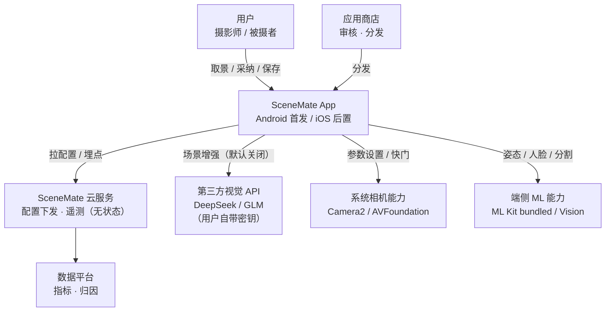
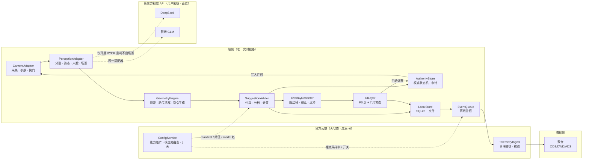
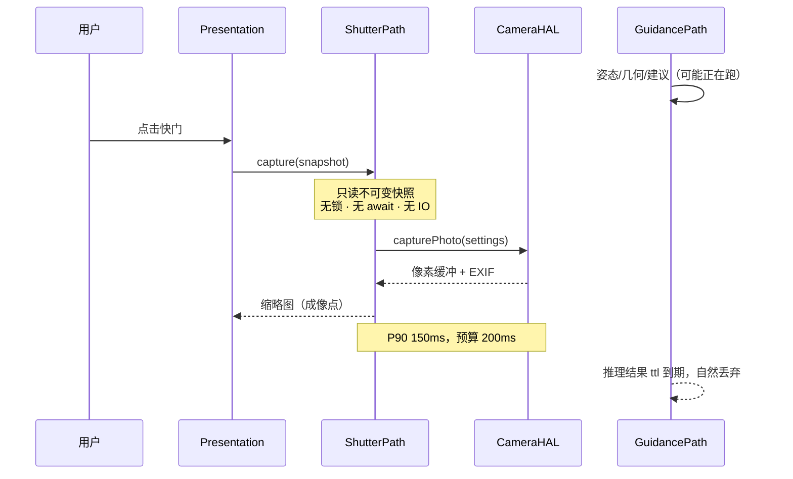
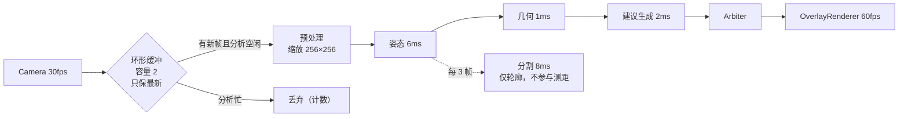
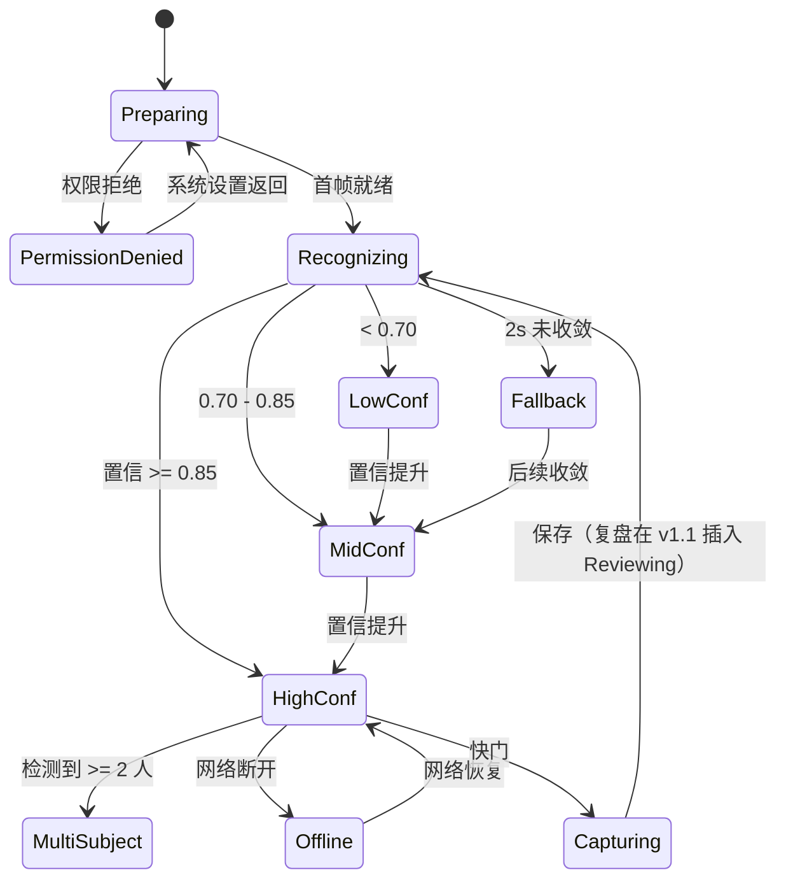
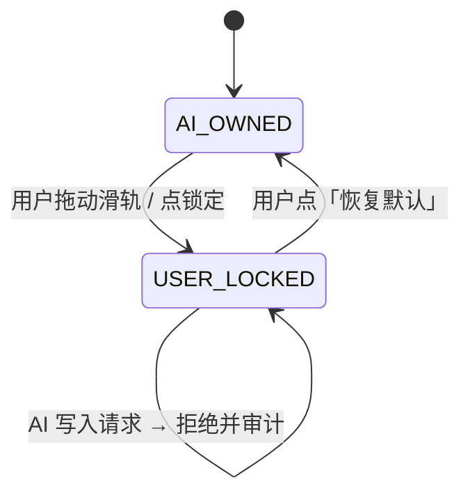

# SceneMate 取景助手 · 技术架构设计文档（TAD）

| 项目 | 内容 |
|---|---|
| 文档版本 | v1.2（10-30 四项决策：Android 先发 / 首发只做 P0 / 免费 + BYOK / 公开上架） |
| 日期 | 2026-10-29 |
| 状态 | Draft → 待评审（Review） |
| 对应需求 | `../01-prd/prd-scenemate-2026-10-29.md` v1 |
| 配套设计 | `../03-design/scenemate-ui.html`（5 屏高保真概念稿） |
| 配套验证 | `../04-poc/poc-deepseek-vision-2026-10-29.md`（DeepSeek 实测报告） |
| 项目索引 | `../README.md`（全部资料入口与阅读路径） |
| 读者 | 工程 / 算法 / QA / 产品 / 法务 / 运维 |
| 覆盖范围 | P0 首发架构（R01–R08，10 周）+ R09–R16 预留 + v2/v3 演进 + 3 年平台化路线 |
| 评审门禁 | 本文第 14 章「架构守护」全部通过，方可进入 M2 编码 |

**修订记录**

| 版本 | 日期 | 变更 |
|---|---|---|
| v1.0 | 2026-10-29 | 首版 |
| v1.1 | 2026-10-29 | 回填三项决策：① 指令 `actor=subject`（§6.4）；② v1 跳过身高输入，改用像素占比作控制量（§6.2.1）；③ MVP 云端槽位接 DeepSeek 视觉 API（ADR-013，含实测数据） |
| **v1.2** | **2026-10-30** | **结构性调整四项**：① **Android 先发**（ADR-014），iOS 后置 4 周；② 首发范围裁到 **P0（R01–R08，10 周）**，R09–R16 进 v1.1（§12.5）；③ 商业模式改为**免费 + 用户自带密钥（BYOK）**，我方云端成本归零（ADR-015、§7.4）；④ **公开上架**，DeepSeek / GLM 双厂商、默认关闭，新增合规义务（§10.6） |

---

## 0. 一页纸摘要（给决策者）

**架构主张：这是一台「实时决策机」，不是一台相机。**

SceneMate 的技术难点不在成像，而在**33ms 内完成一次"看到 → 判断 → 告诉用户怎么做"的闭环**，并且这个闭环必须：断网可用、不阻塞快门、不擅自改用户设置、不依赖我方持续付费的云服务。

八条决定性架构结论：

| # | 结论 | 依据 | 影响 |
|---|---|---|---|
| **A1** | **端侧规则是唯一保底，云端是默认关闭的增强** | 断网可用是硬需求；云端实测 P50 2.2s，且按次计费会随规模线性吃掉毛利（见 §7.4） | 否决 PRD R02「云端 1fps 抽帧」作为主链路；云端只在用户主动开启 BYOK 后可用，关掉即退化为纯端侧 |
| **A2** | **双管线物理隔离**：快门路径与分析/引导路径零共享可变状态 | 快门 P90<200ms 是硬红线，任何锁竞争都会击穿它 | 采集、分析、渲染、参数执行分属四条独立队列，快门路径只读不可变快照 |
| **A3** | **「建议」是一等数据对象，不是代码分支** | 需要可下发、可灰度、可回放、可归因、可 A/B | 统一 Suggestion Schema + 仲裁器（Arbiter）+ 权威状态机（Authority），v2 的自动接管只是新增一个 Actuator，不改主干 |
| **A4** | **端侧感知复用系统能力，自研收敛在几何与建议层** | Android 用 ML Kit **bundled**（姿态 / 人脸 / 分割，均不依赖 GMS）；iOS 后置用 Vision | v1 不训练任何模型，R01 的风险从「模型不确定性」降为「几何 + 人体比例常数」 |
| **A5** | **控制量用「主体像素占比」，展示量才用「米数」** | 不做身高校准时，绝对距离 P90 误差 ≈ **32cm**；但相对位移的误差只与位移量成正比（≈5%），0.45m 位移的误差仅 2.3cm（见 §6.2.1） | 产品决定 v1 **跳过身高输入** → `range_tier=default`：只给「后退半步 / 还差 0.4m」，**不显示「距镜头 2.4m」** |
| **A6** | **云端走 BYOK（用户自带密钥），我方不代付、不中转** | 实测 `deepseek-flash`：延迟 P50 2.2s、¥0.004/次；免费模式下我方无法承担按次成本（见 ADR-015、§7.4） | 客户端直连厂商，密钥只存本机；我方云端只剩配置与埋点两个无状态服务，成本≈0；代价是拿不到服务端调用日志 |
| **A7** | **Android 先发，感知栈以「姿态关键点」为主、分割降级为可选** | 国内安卓多数机型无 GMS，ML Kit 主体分割只有 GMS 版且为 beta、无 SLA；Selfie 分割按近距离自拍训练，2–3m 全身会退化（ADR-014） | 主体外接框改由 33 关键点 + 人体比例常数推导；分割只做轮廓美化与多人分离，不参与测距。iOS 后置时复用同一套 `PerceptionBackend` 契约 |
| **A8** | **首发只交付 P0（R01–R08），图层树只实现 4 层** | 10 周窗口 + Android 首发的不确定性，铺满 18 条需求必然延期（§12.5） | `OverlayRenderer` 首发实现 Silhouette / Footprint / DistanceLabel / InstructionChip 四层；构图线、海平面、姿势提示留注册位不实现，v1.1 加层不改渲染循环 |

**首发技术投入**：P0 范围开发约 38 人日（PRD 口径），加 M0 的不确定性投入（POC / 卷尺标定 / 机型矩阵）约 21 人日；10 周 × 4 开发 ≈ 200 人日容量，利用率约 45%——**约束仍是不确定性，不是人力**。架构侧必须前置 3 件事：① W1 搭出 OverlayRenderer 四层骨架（v1.1 加层不改渲染循环）；② W2 交付 Replay Harness（无 ground truth 时唯一可回归的手段）；③ W3 冻结 Suggestion Schema 与 `ModelProvider` 契约（Android 先发、iOS 后发，契约是两端唯一同步点）。

**两个真正的架构风险**：① **「正确站位没有 ground truth」**（PRD §4.3）——所以本文把「可回放、可标注、可评测」当作一等能力，而不是测试阶段再补；② **Android 首发的姿态外接框精度**——它是唯一可能推翻整个 R01 的技术假设，M0 必须先测，不达标就走 ADR-014 的 Plan B。

---

## 1. 架构驱动因素

### 1.1 从需求到架构能力（只列会改变结构的）

| PRD 条目 | 架构含义 | 落到本文 |
|---|---|---|
| R01 站位引导（P90<800ms） | 需要一条独立的低延迟感知管线 + 世界坐标求解 | §5.3、§6.3 |
| R02 场景识别（规则 <300ms / 增强 <4s） | 端云异步、渐进增强、断网降级 | §7.2、ADR-001 |
| R03 参数一键应用（≤300ms） | 相机控制需要预编译与配置窗口，不能即时串行 | §5.6 |
| R04 置信度分档 | 置信度必须**校准**（calibrated），否则分档是假的 | §6.6 |
| R05 手动优先 | 需要权威状态机 + 审计日志 + 属性测试 | §5.6、ADR-002 |
| R06 快门不阻塞 | 双管线隔离、无锁快照 | §5.2、ADR-004 |
| R07 EXIF 双轨 | 参数需带 provenance（来源） | §8.1 |
| R08 三事件埋点 | 离线队列 + at-least-once + schema 校验 | §9.2 |
| R09/R10 抽屉与叠加层 | R01 与 R10 **必须共用一条渲染管线**（PRD 明示串行） | §5.4、ADR-003 |
| R13 暗光降级 | 策略层可下发、可灰度，不能写死在客户端 | §7.3 |
| R14 2s 兜底/弱网 | 必须有「保底建议生产者」，且建议版本单调 | §5.3 |
| R17 LiDAR（v2） | 测距必须是可插拔的多源接口 | §6.2 |
| R18 模板库（v2） | 模板是**数据**，走配置下发而非发版 | §7.3 |

> **v1.2 范围说明**：首发只交付 **R01–R08**，R09–R16 在架构上保留扩展点但不实现（§12.5）。上表保留全部映射，是为了证明一件事：**后续加需求不需要改结构**，只注册生产者与图层。

### 1.2 质量属性场景（QA Scenario，可验收）

| # | 场景 | 度量 | 架构手段 |
|---|---|---|---|
| Q1 | 用户按下快门时，后台正在跑分割推理 | 点击→成像 P90 <200ms，丢弃率 <0.5% | 双管线 + 不可变快照（ADR-004） |
| Q2 | 地铁隧道断网，用户拍照 | 站位/构图/参数 100% 可用，仅语义标签缺失 | 端侧主链路（A1） |
| Q3 | 连续拍摄 10 分钟 | 无热降频导致的帧率腰斩；机身温度可控 | 自适应质量控制器（§10.2） |
| Q4 | 用户手动把 ISO 拖到 400 | 本会话 AI 对该参数写入次数 = 0 | 权威状态机拒绝写入（§5.6） |
| Q5 | 云端模型服务 5xx | 用户无感，降级为端侧标签，不重试阻塞 UI | 超时 800ms + 熔断 + 静默降级 |
| Q6 | 法务要求「画面不得出境」 | 仅上传特征向量与模糊缩略图，配置开关一键切换 | 数据分级上传（ADR-006） |
| Q7 | 低端安卓机无 MANUAL_SENSOR | 参数滑轨置灰，站位/构图正常 | 能力矩阵（§5.8） |
| Q8 | 新增第 5 类建议（如「换镜头」） | 不改渲染管线、不改快门路径，仅注册插件 | 建议插件化（ADR-003/009） |

### 1.3 约束

| 类型 | 约束 | 架构应对 |
|---|---|---|
| 技术 | 云端无法逐帧（33ms 预算） | 端侧 30fps / 云端异步 |
| 技术 | 第三方 App 拿不到系统计算摄影 | 不做画质承诺；R13 诚实降级 |
| 技术 | 光圈硬件固定 | 景深只能靠距离，站位即景深控制 |
| 平台 | **Android 9.0+ 先发**（A/B 级机型，`MANUAL_SENSOR` 必需）；iOS 15+ 后置 4 周 | 能力矩阵分级，不按 OS 版本分叉；C 级机不进首发支持范围 |
| 团队 | 4 开发 + 1 设计 + 1 QA，**10 周（P0 范围）** | 单仓多模块，禁止过度拆分微服务 |
| 合规 | 公开上架 + 用户自带密钥直连第三方大模型 | 默认关闭 + 一次性告知 + 密钥只存本机（§10.6） |
| 商业 | **首发免费、无内购**；云端成本由用户的 API 密钥承担 | BYOK，我方云端成本≈0（§7.4） |

### 1.4 架构不做什么（与 PRD Non-goals 对齐）

- **不做**云相册/多端同步 → 不建 Blob 同步服务，仅保留 `AssetStore` 接口占位。
- **不做**社区/Feed → 无 UGC 后端、无内容审核链路。
- **不做**视频参数控制 → 无视频编码/转码服务。
- **不做**照片后期编辑器 → 复盘只做评分与一次裁剪，不引入图像编辑引擎。
- **不做**自研训练（v1） → 复用 ML Kit **bundled** 能力（不依赖 GMS）；若 M0 实测姿态关键点在 2–3m 不达标，引入开源预训练模型做 TFLite 集成，仍然不训练，见 ADR-011/ADR-014。
- **不做**内购与订阅（v1） → 无支付 SDK、无权益校验、无价格页；`Entitlement` 接口仅留空实现（§12.5）。

---

## 2. 架构原则

> 原则的作用是**在评审时快速否决方案**。每条都配一条可执行的守护规则（§14）。

| # | 原则 | 含义 | 违反示例（会被否决） |
|---|---|---|---|
| P1 | **端侧优先** | 任何能力先问「能否在端侧 33ms 内完成」；不能才上云 | 把场景分类做成同步云调用 |
| P2 | **快门不可协商** | 快门路径不得等待网络、不得等待推理、不得获取分析锁 | 在快门回调里 `await suggestion` |
| P3 | **建议即数据** | 建议必须可序列化、可版本化、可回放、可下发 | 用 `if scene == "beach"` 硬编码文案 |
| P4 | **权威单一来源** | 某参数当前由谁控制，只有一个状态机说了算 | UI 层自行判断「AI 能不能改」 |
| P5 | **按能力分级，不按平台分叉** | iOS/Android 共享同一套能力契约，差异由 Capability Matrix 表达 | `if (isAndroid) { ... }` 散落各处 |
| P6 | **一切决策可归因** | 每条建议带 source / model_version / confidence / 耗时 | 只上报「已优化」不上报旧值新值 |
| P7 | **大模型只给意图，不给数值** | 方向、米数、ISO 值由确定性算法给出；LLM 只负责语义判断、参数建议与解释文案 | 把模型输出的「向左 0.6m」直接渲染到取景框 |

---

## 3. 关键架构决策（ADR）

> 格式：背景 → 选项 → 决策 → 理由 → 后果 → 复审触发条件。评审时逐条过。

### ADR-001 端云分工：端侧规则保底 + 云端 BYOK 增强

**背景**：PRD R02 要求「云端 1fps 抽帧输出场景/光线/主体三标签，P90<1.5s」。但成本核算显示全量云端不可行（§7.4）。

**选项**：
1. 全量云端 1fps（PRD 原文）
2. 全量云端但降采样（12 帧/会话）
3. 端侧分类为主 + 云端难例复核
4. 纯端侧，无云端

**决策**：选 **3**，并按 v1.2 收敛为「**端侧规则兜底 + 云端 BYOK 可选**」：v1 不训练端侧分类器，端侧用曝光值、直方图亮度、人脸数、地平线角度产出**规则三标签**（0 成本、0 延迟、断网可用）；仅当用户**主动开启 BYOK** 且满足以下任一条件才调用云端：① 端侧规则判不出场景（置信 <0.5）；② 用户点「深度分析」；③ 用户手动刷新。默认关闭，单会话云端调用硬上限 4 次。

**理由**：单帧端侧推理的边际成本为 0，云端为 ¥0.0003–0.015；且端侧无 RTT，天然满足 P90。云端价值不在「每帧都看」，而在「看不懂的时候看一眼」。

**后果**：
- **R02 的验收口径必须改**：原「云端 P90<1.5s」在 BYOK 下不成立（实测 2.29s）。改为两段式——**规则标签 ≤300ms**（保证「2 秒内可用」），**增强 ≤4s**（异步替换，版本单调、不闪回）。
- 需要新增「难例挖掘」链路（端侧低置信帧 → 采样 → 标注 → 训练），见 §9.3。
- **首发「云端」这一格走 BYOK 直连厂商**（ADR-015），我方不部署推理、不代付；自研端侧分类器推迟到 v2；`ModelProvider` 接口层不变。
- 云端 QPS 从 150/DAU/日 降到「仅开启 BYOK 的用户 × ≤4 次/会话」，我方 QPS ≈ 0（请求不经过我方服务器）。

**复审触发**：端侧分类准确率连续 4 周 <75%，或云端单帧成本降至 ¥0.0001 以下。

---

### ADR-002 建议式，但为接管式预留执行层

**背景**：v1 只做建议（用户点「应用」才生效），v2 做 EV/WB 自动接管，v3 做 ISO/快门全接管。若 v1 把「应用参数」写成 UI 里的一次性动作，v2 必然重写。

**决策**：引入三层分离——`Advisor`（产出建议）→ `Arbiter`（仲裁，决定谁上屏）→ `Actuator`（执行，v1 仅有 `UserGestureActuator`，v2 增加 `AutoActuator`）。`Authority` 状态机是唯一裁决者，`Actuator` 无权限绕过。

**后果**：v1 多写约 3 人日的抽象；v2 的自动接管只需实现 `AutoActuator` + `SafetyEnvelope`（安全边界：EV ±1.0、WB 3200–6500K），不改管线。

**复审触发**：v2 立项时。

---

### ADR-003 单一叠加层渲染管线（R01 与 R10 共用）

**背景**：PRD 明确「R01 → R10 共用渲染管线，必须同一开发顺序完成，不允许拆给两人并行」。

**决策**：建 `OverlayRenderer`，采用**图层树 + 声明式图层描述**：

```
OverlayRenderer
├── Layer: SubjectSilhouette   (人形轮廓，随分割更新)
├── Layer: StanceFootprint     (脚印 + 虚线框，随几何更新)
├── Layer: DistanceLabel       (米数，走避让布局)
├── Layer: CompositionGrid     (三分线 / 留白标尺)
├── Layer: HorizonLine         (海平面对齐，>1.5° 转橙)
├── Layer: PoseHints           (姿势 3 选项)
└── Layer: InstructionChip     (首屏唯一一条指令)
```

每个图层声明 `zIndex / 更新频率 / 是否避让主体 / 是否可冻结`。渲染单 pass 合成，避免多次全屏 blit。

**理由**：R10 上线时只是注册两个新图层，不动渲染循环；R16（定时器冻结叠加层）通过 `freeze(layerIds)` 一个调用实现；US-4（倒计时冻结）同理。

**后果**：R01 开发者必须先交付渲染骨架（W5 首日），R10 开发者在其上叠加。这条约束写进排期，不允许「先各写各的」。

---

### ADR-004 双管线物理隔离

**背景**：R06 要求快门 P90<200ms 且调参期间连拍丢弃率 <0.5%。若分析线程与采集线程共享队列或锁，一次 GC/一次推理抖动就会击穿。

**决策**：

| 管线 | 线程/队列 | QoS | 共享状态 |
|---|---|---|---|
| **Capture Path**（快门） | 独立串行队列，最高优先级 | iOS `.userInteractive` / Android `THREAD_PRIORITY_URGENT_DISPLAY` | 只读 `CaptureSettingsSnapshot`（不可变值类型，原子替换） |
| **Guidance Path**（分析+引导） | 独立串行队列 | `.userInitiated` | 只写 `SuggestionStore`（无锁环形/actor） |
| **Render Path**（叠加层） | 主线程 + GPU 队列 | `.userInteractive` | 只读渲染指令 |
| **Actuation Path**（参数应用） | 独立串行队列 | `.userInitiated` | 独占相机配置锁，**永不与快门同帧竞争** |

关键实现细节：
- `AVCaptureVideoDataOutput.alwaysDiscardsLateVideoFrames = true` / Android `ImageAnalysis.STRATEGY_KEEP_ONLY_LATEST` —— 丢帧在源头，不在业务层。
- 快门触发时**不 cancel** 推理任务，而是让推理结果自然过期（`ttl` 到期即丢弃），避免取消风暴。
- 参数应用采用**配置窗口预约**：在预览帧间隙提交，iOS 用 `lockForConfiguration` 的最小持有时间（目标 <40ms），Android 用预构建 `CaptureRequest` 模板替换，避免重建 session。

**后果**：快门路径无网络、无推理、无文件 IO 依赖——这条可用静态依赖检查强制（§14 F1）。

---

### ADR-005 Schema-first 契约 + 双端独立实现（v1 不引入 KMP）

**背景**：双端共享 R02/R03 协议层可省 1.5 周（PRD §9.2）。但 4 人团队引入 Kotlin Multiplatform 的构建复杂度与调试成本，v1 不划算。

**选项**：① 全 KMP 共享；② 各自实现 + 契约测试；③ 共享 C++ 核心。

**决策**：选 **2**。用 JSON Schema 定义 `Suggestion` / `SceneAnalysis` / `CapabilityManifest` / `Event`，通过 codegen 生成 Swift/Kotlin 模型；两端各写实现，用**同一份 golden fixture（≥200 条）**做契约测试，CI 中任一端偏离即失败。

**理由**：共享的是**语义**，不是代码。契约测试的成本远低于 KMP 的构建与心智成本。

**复审触发**：双端领域逻辑差异 >30%，或建议器数量 >6 个（届时评估 KMP 或 Rust 核心）。

---

### ADR-006 抽帧数据三档分级上传

**背景**：PRD 依赖 D1「云端抽帧是否人脸模糊、境内外数据落地」为阻塞级，W4 前必须定稿。架构不能等结论，必须三种都能接。

**决策**：`FrameUploadPolicy` 三档，服务端可下发、可灰度：

| 档位 | 上传内容 | 体积/帧 | 合规风险 | 适用 |
|---|---|---|---|---|
| **L0 仅特征** | 端侧分类器倒数第二层 embedding（256 dim）+ 三标签 | ~1KB | 极低（无可复原像素） | v2 自托管 |
| **L1 模糊缩略图** | 人脸区域高斯模糊后的 640px JPEG（q=60） | ~40KB | 中（需告知+同意） | 难例复核 |
| **L2 原图** | 720p JPEG（q=60），仅 Wi-Fi + 明示同意 | ~70KB | 高（需境内外双落地） | 内测/研究模式 |

**v1.2 修正（BYOK 之后）**：L0 是给**自托管分类头**用的，通用视觉大模型读不懂别人的 embedding——所以一旦走 BYOK 直连厂商，**L0 不可用，实际只有 L1/L2 两档**。

| 档位 | v1.2 状态 | 说明 |
|---|---|---|
| L0 | ❌ 暂不可用 | 保留给 v2 自托管小模型；当前无消费方 |
| **L1** | ✅ **BYOK 默认** | 人脸区域高斯模糊 + 640px JPEG。判断「海边日落/逆光/1 人」靠的是天空、色温、轮廓，**不看五官**，模糊几乎不掉准确率 |
| L2 | ⚠️ 仅用户手动选「最佳效果」 | 明示「将发送未模糊画面」，且仅 Wi-Fi |

端侧先跑 ML Kit Face Detection 做模糊（bundled 版，不依赖 GMS），模糊半径可配置。**把「人脸模糊」从合规负担变成默认行为**——这是本方案最划算的一处交换。

**后果**：合规结论无论落在哪一档，架构不变，只改配置。这也把「端侧抽帧」备选架构（PRD 风险 4）变成同一套代码的一个开关。

---

### ADR-007 端侧模型与能力矩阵走配置下发

**背景**：Android 碎片化（PRD 风险 2）、模型需要灰度与回滚、降级阈值需要运营可调。

**决策**：`CapabilityManifest` 由服务端按 `(platform, device_model, os_version, app_version, ram_class)` 下发，包含：可用模型与版本、分析帧率上限、是否支持手动参数、云端采样率与帧数上限、叠加层样式档位、开关集合。端侧**内置一份兜底 manifest**，断网时用兜底。

**后果**：调参不发版；新机型出问题可远程降级；实验能力天然具备。

**复审触发**：manifest 字段 >40 个时，考虑拆分为「设备能力」与「实验配置」两份。

---

### ADR-008 本地优先存储，无云端相册，但保留资产抽象

**决策**：所有照片、会话、建议、审计日志存本地 SQLite（WAL 模式）+ 文件系统；不上传原图、不做跨端同步。`AssetStore` 接口预留 `remote` 实现，v3 若做云相册可替换。

**理由**：PRD Non-goal 7。且照片是最高敏感数据，本地化同时降低合规成本与存储成本。

---

### ADR-009 建议仲裁器（Arbiter）与「首屏 1 条指令」的机械保证

**背景**：PRD 要求首屏任何时刻只显示 1 条指令文字；但系统同时有站位、参数、构图、姿势、暗光提示 5 类建议源。

**决策**：所有建议进 `Arbiter`，按硬约束 + 打分排序：

```
硬约束（不满足直接淘汰）：
  1. tier == hint 且存在 tier >= weak 的同域建议 → 淘汰
  2. 与当前 Authority 冲突（该参数已被用户锁定）→ 淘汰
  3. ttl 过期 → 淘汰
打分（越大越优先）：
  score = 0.35*confidence + 0.30*information_gain + 0.20*recency + 0.15*domain_weight
  domain_weight: 站位 1.0 > 参数 0.8 > 构图 0.6 > 姿势 0.4
输出：top-1 作为 instruction_chip；其余进抽屉（屏 2），不占首屏
```

**理由**：站位是**不可逆决策**（站错了整张废），参数是可回退的，所以站位权重最高。这与 PRD「痛点 P0：不知道人该站哪」一致。

**后果**：新增建议类型不改 UI 逻辑，只注册 `domain_weight` 与渲染图层。

---

### ADR-010 测距：多源融合 + 置信区间，而非单点真值

**决策**：`RangeEstimator` 接受三个来源，加权融合，输出 `(distance_m, sigma_m, method)`：

| 来源 | 方法 | 精度（3m） | 可用条件 |
|---|---|---|---|
| S1 姿态外接框 + 相似三角形 | 鼻-踝推 `h_px` → `d = f_px × H / h_px` | σ≈19cm（未校准身高） | 全身可见 |
| S2 地平面射线 | 踝点像素 → 射线 ∩ 地平面 | σ≈15–20cm | 相机高度已知、俯仰可测 |
| S3 LiDAR / AR 射线 | ARKit/ARCore hit test | σ≈5cm | Pro 机型 / v2 |

融合规则：S3 可用则权重 0.8（v2）；否则 S1/S2 按可见性加权（脚部可见 → S1 权重高；半身 → S2 权重高）。输出必须带 `sigma`，下游据此决定「是否值得给米数」——`sigma > 0.3m` 时只给「半步/一步」这类离散指令，不报数字。

**理由**：见 §6.2 误差预算。单一方法无法稳定达标，且「报一个错数字」对信任的伤害远大于「不给数字」（PRD 3.5 误判成本不对称）。

---

### ADR-011 端侧感知复用系统能力，自研收敛在几何与建议

**背景**：若自研分割 + 姿态模型，v1 需额外 6–10 人日训练/调优/量化，且双端一致性难保证。

**决策（v1.2，Android 首发）**：把「分割」从测距链路里摘出去，**主体外接框改由姿态关键点推导**。

| 能力 | Android 首发（bundled，不依赖 GMS） | iOS 后置 | v1 角色 |
|---|---|---|---|
| 人体姿态 | `com.google.mlkit:pose-detection`（33 关键点，模型内置） | `VNDetectHumanBodyPoseRequest`（19 点） | **测距主来源**：鼻/踝推外接框 |
| 人体分割 | `com.google.mlkit:segmentation-selfie`（bundled） | `VNGeneratePersonSegmentationRequest` | **不参与测距**：只做轮廓美化、多人分离、避让布局 |
| 人脸检测 | `com.google.mlkit:face-detection`（bundled） | Vision Face Detection | 避让 + L1 上传前模糊 |
| 场景分类 | v1 规则（曝光/直方图/人脸数/地平线）+ BYOK 云端 | 同 | 规则保底，云端增强 |
| 几何求解 | 自研（纯数学，可跨端对齐） | 同 | **差异化核心** |

**为什么不押分割**（三条硬理由）：
1. 国内安卓多数机型**没有 GMS**，而 ML Kit 的 Subject Segmentation 只有 GMS 版，且官方标注 **beta、无 SLA、可能破坏兼容**——不能作为首发依赖。
2. 能离线用的 Selfie Segmentation 是**按近距离自拍训练**的，2–3m 拍全身会明显退化（M0 必测）。
3. R01 真正需要的只是「主体在画面里多高」，**不需要精细轮廓**。用姿态关键点算外接框，误差来源更少、更可控。

**外接框推导**：

```
h_px ≈ (y_ankle − y_nose) / (1 − k_head − k_foot)
  k_head ≈ 0.07   # 鼻尖到头顶 / 身高
  k_foot ≈ 0.04   # 外踝到脚底 / 身高
  → 分母 ≈ 0.89（成年人比例稳定，个体差异 ~2%）
```

**降级链**（每一级都明确增大 sigma，而不是静默给错数）：

| 级 | 顶端锚点 | 底端锚点 | 额外误差 | 触发条件 |
|---|---|---|---|---|
| 1 | 鼻 | 踝 | +0 | 两端置信 >0.6 |
| 2 | 眼/耳 | 膝（按小腿比例外推） | +3% | 脚部出画或被遮挡 |
| 3 | 分割 bbox 顶 | 分割 bbox 底 | +4% | 姿态失败但分割可用 |
| 4 | — | — | — | **不出站位框**，只给构图线 + 「请退后让我看到全身」 |

**理由**：差异化在「几何 + 指令生成」，不在分割模型。用系统能力把不确定性砍掉一半，把 8 人日的 R01 聚焦在真正的难点上；而把分割降级为可选，等于把「GMS 依赖」这个首发级风险直接消掉。

**后果**：`PerceptionAdapter` 需抹平两端关键点定义差异（19 vs 33），并用 golden fixture 保证同一输入下几何输出一致（容差 ±2cm）。**包体反而更小**：姿态模型 bundled 约 5–8MB，比自带 matting 模型省。

**复审触发**：M0 实测「鼻-踝」外接框在 3m 处 P90 误差 >5%，或踝点检出率 <85%（全身可见条件下）。

---

### ADR-012 无 ground truth 的工程解法：Replay Harness 一等公民

**背景**：PRD §4.3 指出「正确站位没有 ground truth」是赛道没人做成的根因之一；风险 3 指出「距离精度无 ground truth，验收扯皮」。

**决策**：W2 交付 `Replay Harness`——把一次真实拍摄录制为**可回放包**：

```
session.scenemate-replay/
├── video.hevc              # 原始 30fps 视频（不解码重编码，保留时间戳）
├── frames.jsonl            # 每帧：pts, 曝光, ISO, 焦距, 内参, 重力向量, 陀螺仪
├── groundtruth.json        # 可选：卷尺实测距离、人工标注场景标签
└── manifest.json           # 机型、OS、App 版本、模型版本
```

回放时用**确定性时钟**驱动管线，输出建议序列，与基线 diff。用途：
1. 回归测试（改一行几何代码，跑 200 个回放包，看建议变化率）
2. 精度评测（有 groundtruth 的包算 MAE / P90）
3. 算法 A/B（离线对比两版模型，不上线）
4. 缺陷复现（用户上报时附带 replay 包，可在工位复现）

**后果**：W2 前必须完成，否则后续所有几何改动都是盲改。这是本文对排期的**唯一硬性插入**（+2 人日，从缓冲扣）。

---

### ADR-013 视觉大模型选型：DeepSeek 实测与双厂商适配

**背景**：需要在不训练模型的前提下，验证「AI 给的场景判断与建议是否真的有人用」。自研端侧分类器需 3–4 周（采集、标注、训练、量化、双端部署），且 v1 前拿不到训练数据。

**选项**：① 自研端侧分类器；② 接入第三方视觉大模型 API；③ 纯规则启发式。

**决策（v1.2）**：选 **②**，但形态改为 **BYOK（用户自带密钥）+ 厂商下拉**。首发支持 **DeepSeek** 与 **智谱 GLM** 两家，都走 OpenAI 兼容端点，各写一个 `ModelProvider` 适配器。

**model 名不写进代码**，走配置下发——因为下面的实测已经证明：模型名只是别名，两个月就会被接管。

**实测数据**（2026-10-29，单图 480×720 JPEG 32KB，`thinking=disabled`，`temperature=0`，`detail=low`）：

| 指标 | 实测 | 要求 | 结论 |
|---|---|---|---|
| 延迟 P50 / P90 | **2285ms / 2368ms**（temp=0，n=4）；默认温度 P90 2853ms | R01 800ms；R02 原定 1.5s（v1.2 改为「规则 300ms + 增强 4s」） | ❌ 进不了实时链路；增强槽位可用 |
| 输入 tokens | 934 | — | 图片按尺寸折算，上限 1024 |
| 输出 tokens | 275–321 | — | JSON 结构完整 |
| 单次成本 | 高峰 ¥0.0041–0.0044 / 空闲约 ¥0.0021 | — | 可接受 |
| Schema 校验 | 4/4 通过（含禁止词、actor 枚举、参数范围） | 100% | ✅ |
| 标签质量 | beach_sunset / backlit / person×1，置信 0.86–0.92 | top-1 ≥80% | ✅（单样本，需扩测） |

**三条实测结论**（比数据本身更重要）：

1. **2.2 秒的延迟决定了它的位置**。R01 要求站位框 800ms 内出现，差 3 倍。因此 DeepSeek 只能服务：场景分析抽屉（用户主动上滑，可接受 loading）、首次会话冷启动、端侧低置信的难例复核。**实时站位框必须由端侧几何给出**。
2. **默认温度下同一张图会给出互相矛盾的方向**。三次调用分别输出「向右 0.6m」「向左半步」「向左半步」；固定 `temperature=0` 后三次完全一致。这说明 LLM 的输出必须视为**不稳定信号**，需要固定温度 + 缓存 + 迟滞三重约束。
3. **实验模型会下线**。`deepseek-v4-flash-vision-exp` 上线两个月即被 V4.1-Flash 接管，模型名只是别名。因此必须有一层 `ModelProvider` 适配，模型名、厂商、协议都可替换。

**后果**：
- 新增 `ModelProvider` 接口（两实现：`DeepSeekProvider` / `GLMProvider`）与 `SuggestionSanitizer`（schema 校验、范围 clamp、禁止词过滤、置信度上限截断）。
- 新增 `ByokKeyStore`：Android 用 Keystore 派生密钥 + 加密 SharedPreferences；iOS 用 Keychain（后置）。**密钥永不上传、不进日志、不进崩溃报告**（crash 上报需脱敏 header）。
- **错误映射统一**：`401` 密钥无效 / `402` 余额不足 / `429` 限流 / 超时 → 一律映射为「增强能力不可用」，UI 只给一句人话 + 「去设置」，**不阻断拍摄**。
- **本地用量计数**（只存本机，不上报）：设置页显示「本月约 ¥2.4」，避免用户「偷偷烧钱」的负面体验——这是 BYOK 产品化成败的关键细节。
- LLM 输出**不得直接决定数值**（P7）：它可以判断「这里该侧移避开正逆光」，但「向左 0.6m」这个数必须由几何求解器填。
- 同一 `frame_hash` 的结果缓存 30s；建议版本单调，最小展示 1.2s（复用 §5.3 机制）。
- 调用护栏：单设备 20 次/日、单会话 4 次，超出静默降级为端侧规则。
- **无服务端日志**：数据回流只能靠端侧 `cloud_scene_result` 事件（记 provider / model / 标签 / 置信 / 耗时，**不含图像**），这是 BYOK 换来的代价。

**复审触发**：BYOK 开启率 <5%，或某厂商端点连续 7 天失败率 >10%，或扩测后标签准确率 <75%，或自研端侧分类器就绪。

---

### ADR-014 Android 先发，iOS 后置 4 周

**背景**：v1.0 建议 iOS 先发（Vision 分割质量更稳、机型矩阵简单）。2026-10-30 业务侧决定 **Android 先发**。架构不评价该决策，只承担其后果——而这些后果比「换个平台写 UI」要深。

**选项**：① Android 先发；② iOS 先发；③ 双端并行。

**决策**：选 **①**。Android 主线交付 P0，iOS 在 Android 提审后启动，复用同一套 Schema 与 fixtures。

**四条必须一起改的后果**：

1. **感知栈换主**：分割不能作为首发依赖（无 GMS / beta / 近距离训练），主体外接框改由姿态关键点推导（ADR-011）。这不是降级，是把不确定性从「模型质量」换成「人体比例常数」。
2. **CameraX 不再是保底**：既然不覆盖 C 级机，直接上 **Camera2**（`MANUAL_SENSOR` + `MANUAL_POST_PROCESSING`），省掉一层 CameraX 兼容层。代价是自研预览/对焦/曝光的样板代码约 +3 人日。
3. **精度目标改成「不设距离硬指标」**：绝对距离 P90 ≈32cm 是物理决定的，靠换感知方案救不回来。验收看**指令正确率 ≥90%**；指令粒度只到「半步 / 一步」，死区从 0.15m 放宽到 **0.25m**——否则框会在阈值附近来回跳，比不给还糟。
4. **团队拓扑翻转**：§13.5 的「iOS 主线」改为「**Android 主线**」；R01 与 R10 必须同一人的约束不变，但这个人现在是 Android 开发。iOS 后置时若此人不可复制，iOS 会再花 3–4 周。

**Plan B（M0 不达标时）**：若「鼻-踝」外接框在 3m 处 P90 >5%，依次启用——① 引入开源人像 matting 模型（TFLite，+6MB，+2 人日）；② 首发只做**七分身/半身**构图（脚部不入画，k_foot 项消失）；③ 推迟 Android 首发 3 周补精度。

**复审触发**：M0 实测外接框 P90 >5%，或 A/B 级机型覆盖率 <40%（意味着「不考虑低端机」等于放弃大半市场，需重新讨论）。

---

### ADR-015 BYOK：密钥治理与「无中转」架构

**背景**：首发免费、无内购、公开上架。按次计费的视觉 API 在免费模式下没有商业闭环——5 万 DAU 全量约 ¥375% 收入（§7.4），BYOK 是唯一能同时满足「免费」与「有云端增强」的形态。

**决策**：客户端**直连**厂商，我方不中转、不托管密钥、不代付。

```
SceneEnhancer（端侧）
  ├── 读 ByokKeyStore（Keystore 加密）
  ├── 选 ModelProvider（DeepSeek / GLM，配置下发）
  ├── HTTPS 直连 api.deepseek.com | open.bigmodel.cn
  └── 结果过 SuggestionSanitizer → 进 Arbiter（source=vendor_api）
```

**四条设计约束**：

| 约束 | 做法 | 理由 |
|---|---|---|
| 密钥安全 | Keystore 派生密钥加密存储；不写日志、不进崩溃报告、不做备份导出 | 密钥泄露 = 用户直接经济损失，比数据泄露更敏感 |
| 默认关闭 | 首次开启弹一次性说明（画面将发送至所选服务商）；可随时关闭并一键清除密钥 | 告知义务不能靠隐私政策藏在二级页 |
| 可观测 | 端侧记 `cloud_scene_result`（provider / model / 标签 / 置信 / 耗时 / 错误码），**不含图像** | 没有服务端日志，这是唯一的数据回流通道 |
| 可诊断 | 设置页「测试连接」按钮 + 本地用量估算 | BYOK 的头号客诉是「为什么不能用」，不是「不准」 |

**代价（必须写进风险登记册）**：
- 无法远程换 key、限流、封禁滥用——所有护栏只能在端侧，可被绕过。
- 无法做服务端 A/B（不同用户不同模型）——只能用埋点里的 provider/model 做**事后分层**，不是随机实验。
- 用户 key 失效、余额不足、区域不可达，都会表现为「AI 变笨」，**差评会记在我们头上**。这是 BYOK 最大的隐性成本。

**复审触发**：若上线付费版并内置额度，必须新增 `ProxyGateway`（我方中转），届时 ADR-006 的 **L0 档复活**，成本模型回到 §7.4 的「自托管」列。

---

## 4. 系统视图

### 4.1 C4-L1 系统上下文



### 4.2 C4-L2 容器视图



**读图要点**：实时链路上**没有任何云端依赖**。两条虚线都是异步、可失败、默认关闭的；关掉 BYOK 后，整个系统只剩实线——这是「断网可用」的结构保证，不是靠容错代码。

### 4.3 关键数据流：一次 3 秒的拍摄

| t | 端侧动作 | 云端 | 用户可见 |
|---|---|---|---|
| 0ms | 相机启动，首帧入环形缓冲（容量 2） | — | 预览 |
| 33ms | 姿态（4ms）+ 几何（1ms）→ 外接框 | — | — |
| 66ms | 第 2 帧确认（迟滞），生成 stance 建议 | — | 站位框淡入 |
| 120ms | 规则三标签（曝光/直方图/人脸数，<1ms） | — | 胶囊「海边日落 · 大概率」 |
| 400ms | 参数建议生成，进抽屉（不占首屏） | — | EXIF 条更新 |
| 800ms | 已开 BYOK 且规则判不出 → 人脸模糊 + L1 编码 | — | 胶囊「增强识别中」 |
| 3.1s | 增强结果回来，refine（version+1，不覆盖已上屏的强建议） | 厂商 2.3s | 标签更新，**不闪回** |
| 用户按快门 | 快门路径直通，读快照 | — | 成像 P90 150ms |

---

## 5. 客户端架构

### 5.1 分层与模块

```
App
├── Presentation        P0 屏 + 7 异常态（抽屉与复盘 v1.1 补齐）；只依赖 Domain，不直接碰 Camera/ML
├── Domain              Session / Suggestion / Authority / Policy（纯逻辑，可单测）
├── Capability          Perception / Geometry / Guidance / Capture / Telemetry
└── Platform            平台抽象：CameraHAL / MLRuntime / Sensor / Store / Net
```

| 模块 | 职责 | 关键类 | 依赖规则 | 归属 |
|---|---|---|---|---|
| `Presentation` | 渲染 UI、手势、状态展示 | `CameraScreen`, `SceneDrawer`, `ParamPanel`, `ReviewScreen` | → Domain | 端侧 A |
| `Domain.Session` | 会话生命周期、状态机 | `SessionStateMachine` | 无 | 端侧 A |
| `Domain.Suggestion` | 建议模型、仲裁、版本 | `Suggestion`, `Arbiter`, `SuggestionStore` | → Policy | 端侧 A |
| `Domain.Authority` | 参数权威、锁定、审计 | `AuthorityStore`, `ParamAuditLog` | 无 | 端侧 A |
| `Capability.Capture` | 采集、参数应用、快门 | `ShutterPath`, `ParamActuator` | → Platform.CameraHAL | 端侧 A |
| `Capability.Perception` | 分割/姿态/人脸/场景 | `PerceptionPipeline` | → Platform.MLRuntime | 端侧 B |
| `Capability.Geometry` | 测距、站位求解、指令生成 | `RangeEstimator`, `StanceSolver`, `InstructionWriter` | 纯数学 | 端侧 B |
| `Capability.Telemetry` | 事件队列、补报 | `EventQueue` | → Platform.Net | 平台 C |
| `Platform.*` | 双端适配 | `AVFCameraAdapter`, `Camera2Adapter`, ... | 无 | 端侧 A/B |

**依赖铁律**：`Presentation → Domain → Capability → Platform`，禁止反向与跨层。`Capability.Capture` **不得**依赖 `Capability.Perception`（ADR-004 的结构保证）。

### 5.2 快门路径（时序）



**性能分解（骁龙 8 Gen1 级 Android 实测基线，需 M0 校准；iOS 后置时重测）**：

| 环节 | P50 | P90 | 说明 |
|---|---|---|---|
| 触摸 → 快门命令 | 8ms | 14ms | 主线程，禁止任何同步调用 |
| 曝光 + 读出 | 60ms | 110ms | 取决于曝光时间（1/125s ≈ 8ms 曝光） |
| ISP + 编码启动 | 35ms | 55ms | HEIF/JPEG 硬件编码；中端机慢 10–15ms |
| 缩略图回传（成像点） | 15ms | 25ms | 到此用户认为「拍到了」 |
| **合计** | **118ms** | **204ms** | ⚠️ 贴近红线，M0 必须实测 |

> 若 M0 实测 P90 >180ms，第一优先级是把「缩略图回传」提前到编码前（用 preview buffer 直接生成），而不是优化算法。

### 5.3 引导管线（帧调度与背压）



**背压策略**：
- 分析队列串行，**同时最多 1 帧在飞**；忙则丢帧，丢帧计数进指标（`frame_drop_rate`）。
- 渲染以 60fps 独立跑，用**插值**在两次分析结果之间平滑（避免 30fps 建议导致 60fps 渲染卡顿）。
- B 级机（manifest `max_analysis_fps=24`）分析降频，渲染仍 60fps；C 级机不进首发（§5.8）。

**渐进增强与单调性**（解决「框乱跳」）：
```
version 单调递增；UI 只接受 version > current
且满足以下之一才替换：
  a) 置信度提升 ≥0.05
  b) 建议类型变化（如 stance → params）
  c) 当前建议 ttl 到期
最小展示时长 1.2s（防闪烁）
```

**2 秒兜底**（R14）：`FallbackProducer` 在 `session_start + 2000ms` 无条件产出一条 `source=fallback` 的构图建议（三分线 + 默认全身占比 0.72），`confidence` 标记为 `band=medium` 但不报具体数值。它**优先于**后续低置信建议（防止「先给了能用的，又被更差的替换」）。

### 5.4 叠加层渲染与避让

**避让算法**（满足 R01「主体包围盒外扩 15% 内不得绘制文字」）：

```
输入：subjectBBox（归一化）、候选锚点 8 个（四角 + 四边中点）、文本尺寸
1. 计算禁区 = subjectBBox 外扩 15%
2. 淘汰锚点落在禁区内或超出安全区（含刘海/圆角/home indicator）
3. 对剩余锚点打分：
   score = 1.0*不遮挡 + 0.5*距主体距离（归一化）+ 0.3*屏幕边缘余量 - 0.4*与已占位元素重叠
4. 取最高分；若全部淘汰 → 退化为「底部胶囊」单行模式（不画引线）
```

**迟滞（hysteresis）**：目标位移 <0.25m 且方向未变 → 不更新；连续 3 帧一致才提交。这直接对应 PRD 3.5「延迟抖动」风险——Android 首发的感知噪声更大，死区必须比 iOS 方案更宽。

**渲染预算**：单帧合成 ≤4ms（GPU），图层数 ≤7。超过则合并静态图层（网格/标尺）为离屏纹理。

### 5.5 会话状态机（与 PRD 7.2 的 7 种异常态对齐）



**状态与能力矩阵**（谁能显示什么，机械保证 R04）：

| 状态 | 站位框 | 相对位移（还差 x m） | 参数建议 | 首屏文案 | 胶囊数值 |
|---|---|---|---|---|---|
| HighConf (≥0.85) | ✅ 实线 | ✅ | ✅ 可应用 | 1 条 | ✅ 显示 |
| MidConf (0.70–0.85) | ❌ | ✅ | ⚠️ 仅展示不可一键应用 | 1 条 | ✅ 显示 |
| LowConf (<0.70) | ❌ | ❌ | ❌ 显示「未接管」 | 1 条（中性表述） | ⚠️ 仅显示档位 |
| Fallback (2s) | ✅ 虚线 | ❌ | ❌ | 1 条 | ❌ |
| MultiSubject | ✅ 仅主主体 | ✅ | ✅ | 1 条 + 「以中间人物为准」 | ✅ |
| Offline | ✅ | ✅ | ✅ | 1 条 | ❌（显示「离线」） |
| PermissionDenied | ❌ | ❌ | ❌ | 全屏说明 + 跳转 | ❌ |

> **绝对米数不在表内**：v1 `range_tier=default`，任何状态都不显示「距镜头 2.4m」，只显示「还差 0.4m」。这条由 schema 强制（§8.1），不靠 UI 自觉。

> **注**：PRD R04 要求「数值在胶囊可见」，但 3.5 又要求「低置信不报虚高数值」。架构解法：显示的是**校准后的档位**（高/中/低），仅当模型完成置信度校准（ECE<0.05）后才显示百分比。见 §6.6。

### 5.6 参数权威与「手动优先」的机械实现



**写入协议**（唯一入口，任何 AI 写参数必须走这里）：

```
func applyAI(param, value, reason) -> ApplyResult {
    guard authority.state(param) == .aiOwned else {
        audit.log(.rejected, param, reason)   // 埋点断言：v1 中此分支必须为 0
        return .rejected
    }
    actuator.apply(param, value)              // 配置窗口预约，≤300ms
    audit.log(.applied, param, old, new, reason)
    return .applied
}
```

**参数应用时序**（R03 ≤300ms）：

| 环节 | 耗时 | 手段 |
|---|---|---|
| 参数编译为设备值 | 8ms | ISO/快门→`CMTime`/ns 的预计算表 |
| 获取配置锁 | 20–60ms | 只在预览帧间隙申请，超时 80ms 则重试一次 |
| 提交 + 生效 | 40–120ms | iOS `setExposureModeCustom`；Android 替换 `CaptureRequest` 模板 |
| 预览确认 | 30ms | 等下一帧确认参数已生效（不是等画面稳定） |
| **合计 P90** | **≈230ms** | 预算 300ms |

**属性测试**（CI 必跑）：随机生成 10,000 组「用户手势 / AI 写入」交错序列，断言「用户锁定后 AI 写入成功次数 == 0」。这把 R05 从「靠自觉」变成「靠机器」。

### 5.7 线程、内存与功耗预算

| 资源 | 预算 | 手段 |
|---|---|---|
| 内存峰值 | ≤180MB（中端机） | 帧缓冲 2 帧（1080p YUV ≈ 3MB/帧）；模型常驻 ≤30MB；照片流式写盘 |
| 冷启动到首帧 | ≤1.2s | 相机 session 预热、模型懒加载（先几何后场景） |
| 连续拍摄 10 分钟 | 无降频或可观测降级 | 热状态驱动质量档位（§10.2） |
| 电量 | 10 分钟连续取景 ≤6% | 分析降频、GPU 合成、屏幕外不推理 |
| 包体增量 | ≤25MB | 模型 ≤8MB（量化 int8），其余为代码 |

### 5.8 平台抽象与能力矩阵

```json
{
  "device_class": "android_mid",
  "manual_sensor": true,
  "lidar": false,
  "max_analysis_fps": 24,
  "range_tier": "default",
  "models": [
    { "provider": "deepseek", "base_url": "https://api.deepseek.com/v1",
      "model": "deepseek-chat", "unit_cost": 0.004 },
    { "provider": "glm", "base_url": "https://open.bigmodel.cn/api/paas/v4",
      "model": "glm-4v", "unit_cost": 0.006 }
  ],
  "byok": { "enabled": true, "max_calls_per_session": 4,
            "max_calls_per_day": 20, "upload_mode": "L1" },
  "overlay_layers": ["silhouette", "footprint", "distance_label", "instruction_chip"],
  "features": { "composition_grid": false, "horizon_align": false,
                "pose_hints": false, "review_score": false }
}
```

> `model` 名与 `unit_cost` 都走配置——厂商改价或换模型时，**改配置不发版**（ADR-013 的实测教训）。`overlay_layers` 只列 P0 四层，v1.1 加层时数组变长，渲染循环不变。

**设备分级**（Android 首发口径；分级用于 QA 矩阵与降级，不用于功能阉割）：

| 级别 | 判定 | 分析帧率 | 感知档 | 参数控制 | 首发支持 |
|---|---|---|---|---|---|
| **S** | 骁龙 8 Gen2+ / 天玑 9200+，8GB+ | 30fps | `pose_full` | 全支持 | ✅ |
| **A** | 骁龙 8 Gen1 / 7+ Gen3 / 天玑 9000，8GB | 30fps | `pose_full` | 全支持 | ✅ |
| **B** | 骁龙 7 系 / 天玑 8000，6–8GB | 24fps | `pose_full` | 多数支持 | ✅ |
| **C** | 骁龙 6 系及以下、无 `MANUAL_SENSOR` | 15fps | `pose_lite` | 置灰 | ❌ 仅基础模式 |

**C 级机策略（2026-10-30 决策：初期不考虑低端机）**：不做适配、不做专项优化。安装后首启检测机型，进入「基础模式」——只给构图三分线，**不出站位框、参数面板置灰**，并给一句明示「当前机型性能不足，站位引导已关闭」。同时在商店描述里写明支持机型范围，把预期管理前置，避免 1 星差评。

> 这条边界要守住：**C 级机不进测试矩阵、不进灰度、不进性能预算**。一旦为它做妥协（比如把分析帧率降到 8fps），会连带拖慢 A/B 级的体验。

---

## 6. 端侧感知与几何（差异化核心）

### 6.1 管线分解

| 阶段 | 输入 | 输出 | 耗时预算 | 实现 |
|---|---|---|---|---|
| 采集 | Camera 30fps | 1080p YUV | 2ms | Camera2（首发）/ AVFoundation |
| 预处理 | 1080p | 256×256 RGB | 3ms | GPU（GLES / Metal） |
| **姿态** | 256×256 | 33 关键点 | **6ms** | ML Kit Pose（bundled） |
| 人体分割（可选） | 256×256 | mask | 8ms（每 3 帧一次） | ML Kit Selfie Segmentation |
| 规则场景标签 | 直方图 + EXIF + 人脸数 | 三标签 + 置信 | **<1ms** | 纯端侧规则，无模型 |
| 几何 | 关键点 + 内参 + 重力 | 距离、站位、指令 | 1ms | 自研纯数学 |
| 合成 | 图层树 | 帧 | 4ms | GPU |

**v1 关键路径：2 + 3 + 6 + 1 + 4 = 16ms / 33.3ms，余量 17ms。**

分割**不在关键路径上**——它不参与测距（ADR-011），只在「需要画人形轮廓」时跑，且每 3 帧一次（10Hz 足够，轮廓不需要 30Hz），摊薄后 <3ms/帧。v2 若上端侧场景分类（12ms / 每 5 帧），仍在预算内。这条余量是刻意留的：Android 中端机的 GPU 与 NPU 调度抖动远大于 iOS，16ms 的占用才有 2 倍的抖动容忍。

### 6.2 测距误差预算（关键论证）

**模型**：`d = f_px × H / h_px`（相似三角形），`f_px = f_mm / sensor_width_mm × image_width_px`。

以 3m、1.70m 被摄者、26mm 等效、4032px 宽为例：`h_px ≈ 1599px`（占 4:3 画面高度 52.9%）。

**误差传播**：`σ_d/d = √[(σ_f/f)² + (σ_H/H)² + (σ_h/h)² + (σ_θ)²]`

| 误差源 | 相对误差（1σ） | 3m 处贡献 | 说明 |
|---|---|---|---|
| 焦距标定 | 0.3% | 0.9cm | EXIF/内参，可忽略 |
| **身高假设 H** | **5.1%** | **15.3cm** | 默认 1.70m，真实 1.55–1.85m |
| 姿态外接框（鼻-踝） | 2.5% | 7.5cm | 关键点抖动；踝点丢失时走降级链（ADR-011） |
| 人体比例常数 | 2.0% | 6.0cm | k_head/k_foot 个体差异（±0.015 / ±0.01） |
| 俯仰角（2°） | 2.3% | 6.9cm | 陀螺仪可测，残差为主 |
| **RSS 合计** | **6.5%** | **19.4cm** | |
| **P90（1.645σ）** | — | **31.9cm** | ❌ 仍超 ±20cm，但**不影响引导**（见 §6.2.1） |

**换感知方案救不了绝对距离**：误差由身高假设主导（15.3cm / 19.4cm = 79%）。把分割换成姿态，改善的是**鲁棒性**（不被裙摆、遮挡、GMS 缺失击穿），不是精度。这条要写进预期管理，否则团队会反复尝试「换个模型把它做准」，而这是物理上做不到的。

**最坏系统性偏差**：真实身高 1.55m 按 1.70m 估算 → 距离高估 `(1 - 1.55/1.70) × 300cm = 26.5cm`。这不是随机误差，**无法通过多帧平均消除**。

**结论与对策**（对应 ADR-010）：

| 方案 | P90 误差（3m） | 成本 | 采纳 |
|---|---|---|---|
| 默认身高 1.70m | **31.9cm** | 0 | v1 唯一档，且**不显示米数** |
| 身高校准（用户输入一次，或从历史照片估计） | **~22cm** | 1 人日 | v1.1 可选（B 档） |
| 地平面射线 + 身高融合 | ~19cm | 2 人日 | v1.1 增强 |
| LiDAR / AR hit test | **≤5cm** | 3 人日（v2，仅 iOS Pro） | v2 的 A 档 |

**决策（2026-10-29，v1.2 沿用）：v1 跳过身高输入，`range_tier=default`。**

> **命名说明**：精度档位改用语义名 `precise / calibrated / default`，不用 A/B/C——避免与设备分级（S/A/B/C）撞名。代码里就写这三个值，不写字母。

这不是妥协，因为引导闭环根本不需要绝对距离——

#### 6.2.1 控制量与展示量的分离

引导真正需要的不是「距离」，而是「主体在画面里占多大」。后者无量纲，与身高无关。

| 量 | 依赖身高 | 3m 处误差 | 用途 |
|---|---|---|---|
| 主体像素占比 α | ❌ 否 | ±2%（分割框抖动） | **控制量**：驱动「前进/后退」 |
| 相对位移 Δ | 线性（∝H） | 0.45m 位移 → **±2.3cm** | **指令**：「后退半步」 |
| 绝对距离 d | 线性（∝H） | **±32cm（P90）** | 仅展示，`default` 档禁用 |

推导：`d` 与 `d*` 都正比于 H，故 `Δ = d* − d` 也正比于 H，其**相对误差恒等于身高的相对误差（5.1%），不随距离放大**。0.45m 的位移误差只有 2.3cm，完全够用。

结论：
- 控制回路用 α（目标 α\* 由构图模板给定，如全身 0.72），**不需要任何标定**。
- 「还差 0.4m」可以说，「距镜头 2.4m」不能说。
- 因此跳过身高输入**不损失引导质量**，只损失一个展示字段。

**对产品的三条建议（已按决策更新）**：
1. ~~首次引导加身高输入~~ → **v1 不做**，仅在设置页保留入口；`calibrated` 档（~22cm）作为 v1.1 的可选增强。
2. 验收口径从「距离误差 ±20cm」改为「**指令正确率 ≥90%**」——「半步」（≈35cm）的容错远大于米数显示。这条在 Android 首发下更关键：精度不占优时，**用指令粒度换正确率**。
3. 屏 1 文案由「距镜头 2.4m · 后退半步」改为「**后退半步（约 0.4m）**」；v1.1 的 R09 俯视图标注用「还差 0.4m」，不用绝对米数。

### 6.3 站位求解

**目标**：给定构图模板（如「全身占画面 72%」），求被摄者应站的世界坐标，再投影到屏幕画脚印。

```
输入：cameraPose(位置, 姿态四元数), intrinsics(f_px, cx, cy), 被摄者身高 H,
     模板参数 alpha（目标像素高占画面比例）, 三分线目标 x*
1. 目标距离 d* = f_px × H / (alpha × frame_height)
   例：alpha=0.72, H=1.70, f=2822, frame_h=3024 → d* = 2.20m
2. 目标横向偏移（世界系）：x*_world = (u* - cx) / f_px × d*
3. 当前被摄者世界坐标：由踝点射线 ∩ 地平面求得 (x_c, z_c)
4. 位移向量 Δ = (x*_world - x_c, d* - z_c)
5. 量化：|Δ| < 0.25m → 不提示（死区，Android 首发放宽）；
   否则只映射「半步 / 一步」（半步 ≈ 0.35m，一步 ≈ 0.65m），不出 0.1m 级数字
6. 生成指令（见 §6.4）
```

**注意（v1 实际实现，`range_tier=default`）**：身高 H 不可信，`d*` 只作内部参考、不上屏。实际闭环是「把主体像素占比 α 调到 α\*」：求解器每帧输出 `Δα`，指令生成器把 `Δα` 映射为「半步 / 一步」或相对米数（`Δ = f_px·H·(1/α\* − 1/α)/frame_h`）。`d*` 仅在 `calibrated` / `precise` 档用于俯视图标注。

**多人场景**：取 bbox 面积最大者为主主体，其余透明度 50%，文案加「以中间人物为准」（PRD 屏 1 多人态）。主主体切换需连续 5 帧稳定，防抖。

### 6.4 指令生成（「只给方向和距离，不给形容词」的机械保证）

**指令对象已定（2026-10-29）**：拿手机的是「你」（摄影师），画面里的是「她」（被摄者）。

| 角色 | 谁 | 文案视角 | 示例 |
|---|---|---|---|
| `photographer` | 拿手机、看屏幕的人 | 第二人称 | 「你蹲低 20cm」「你向左半步」 |
| `subject` | 画面里的人 | 第三人称（说给摄影师听） | 「让她后退半步」「让她向左 0.6m」 |

- **默认 `actor=subject`**：站位是被摄者的动作，且 C 类（帮女友拍照的男生）是主攻人群。
- 切到 `photographer` 的场景：主体背后没有空间（S3 室内餐厅）、主体是老人小孩不便移动、用户主动点「我来动」。
- **文案永远面向摄影师**——只有他看得到屏幕。所以 `actor=subject` 时必须用第三人称，不能写「后退半步」这种无主语句。
- `{subject}` 占位默认「她」，设置可改「他 / TA / 被摄者」。**不做性别识别**，不可靠也不合适。

**模板 DSL**（禁止自由文案）：

```
{actor}{direction}{magnitude}
actor      ∈ {你, 让她, 让他, 让 TA}
direction  ∈ {向前, 后退, 向左, 向右, 蹲低, 站高, 举高, 放低}
magnitude  ∈ {半步, 一步, 两步, 0.6m, 1.0m, 20cm, 40cm}
约束：1 个 actor + 1 个 direction + 1 个 magnitude，不允许叠加
禁止：横向位移 <0.3m（低于 0.25m 死区，必抖动）
禁止词表：构图 / 光线 / 氛围 / 感觉 / 注意 / 尝试 / 适当 / 一些
```

**CI 校验**：所有 `InstructionTemplate` 走 lint，命中禁止词即构建失败。这比「设计评审时提醒」可靠。

**语音是自然延伸**：被摄者看不到屏幕，摄影师必须复述一遍。`SuggestionConsumer` 预留 `Voice` 实现（v1.5），把「让她后退半步」直接外放，省掉这次人际转述——这是 C 类场景最真实的摩擦点，也是 PRD 没写但用户研究里反复出现的「社交尴尬」。

### 6.5 场景分类器（v1 规则为主 + BYOK 增强，v2 自研）

> **v1 实现说明（ADR-013 / ADR-015）**：v1 不自研端侧分类器，也**不默认调用云端**。端侧用**规则**产出三标签（曝光值、直方图亮度、人脸数、地平线角度，<1ms，断网可用）——这是**主实现**，不是兜底；云端只在用户开启 BYOK 且规则判不出时作为增强（2.3s，用户自付）。下表是 v2 的端侧模型规格，届时用它把「规则太粗」这一条补上。

| 项 | 规格 | 理由 |
|---|---|---|
| 输入 | 224×224 RGB | 与主流 backbone 对齐 |
| 输出 | 场景 12 类 / 光线 4 类 / 主体 4 类 + 各自置信 | 对应 PRD 三标签 |
| 结构 | MobileNetV3-Small / EfficientNet-Lite0 级别 | 端侧 8–12ms |
| 体积 | ≤2MB（int8 量化） | 包体预算 |
| 准确率目标 | 场景 top-1 ≥80%（100 张测试集，PRD R02 验收） | |
| 训练数据 | 公开数据集 + 内测采集（需合规） | 见 §9.3 |
| 校准 | Temperature Scaling，目标 ECE <0.05 | 分档表达的前提（§6.6） |

### 6.6 置信度校准（被低估的关键）

PRD 用 0.85 / 0.70 做三档切分，但**未校准的 softmax 输出不可直接当概率用**（现代网络普遍过自信）。若不校准，「≥85% 强引导」会频繁给出错误强引导，直接击穿 G2 信任目标。

**架构要求**：
1. 每个模型发布前必须在**留出集**上做校准，输出 `calibration.json`（温度参数 / isotonic 分箱）。
2. 端侧推理后先校准再进 Arbiter。
3. 监控 `ECE` 与「高置信错误率」，任一超阈值触发模型回滚（§11）。
4. 冷启动期（样本 <1000）**不显示百分比**，只显示档位。

---

## 7. 云端架构

### 7.1 服务拆分（BYOK 之后，云端被削到最小）

> 免费 + BYOK 意味着**云端不再承载任何推理**。v1 我方只保留两个无状态服务，共用一个部署单元；没有 GPU、没有对象存储、没有模型仓库。

| 模块 | 职责 | 部署 | 状态 |
|---|---|---|---|
| `config` | 能力矩阵、模型路由表（provider / model 名）、阈值、开关 | 同进程 | ✅ 必需 |
| `telemetry` | 事件批量接收、schema 校验、入 Kafka | 同进程（可独立扩容） | ✅ 必需 |
| ~~`scene`~~ | ~~接收图片、返回三标签~~ | — | ❌ 删除（客户端直连厂商） |
| ~~`router`~~ | ~~服务端模型路由~~ | — | ❌ 删除（路由表下发给客户端） |
| ~~`inference`~~ | ~~GPU 推理~~ | — | ❌ 删除（v2 才需要） |

**为什么删掉 `scene` 是对的**：它唯一的价值是「藏住 API Key + 统一计费」。BYOK 把这两件事同时消掉了，留着它就是给自己造一个**免费代理**——既烧钱，又把「数据处理者」的身份揽到身上。

### 7.2 什么时候才调用云端（客户端侧策略）

```
触发前置条件（全部满足）：
  ① 用户在设置里开启 BYOK，且「测试连接」通过
  ② 当前网络非计量蜂窝（或用户显式允许）
  ③ 本会话 < 4 次，本日 < 20 次

触发条件（满足任一）：
  a) 规则引擎判不出场景（置信 < 0.5）
  b) 用户点「深度分析」
  c) 用户手动刷新

永不触发：
  - 站位框 / 距离 / 构图指令 → 端侧几何已足够，且 2.3s 延迟不可接受
  - 用户未开启 BYOK → 全程不联网（飞行模式下功能完整）

发送前处理：
  人脸检测 → 高斯模糊（L1）→ 640px JPEG q60 → base64
  或用户选「最佳效果」→ 720p 原图（L2），仅 Wi-Fi + 二次确认
```

**关键设计**：把「是否上云」的决定权交给用户，而不是我们自己猜。这样既满足告知义务，也让「不联网也能用」变成**可验证的事实**——评审时可以直接飞行模式演示。

### 7.3 模型路由与配置下发

```
ModelRouter（在客户端，不在服务端）:
  providers = config.models            # 下发：deepseek / glm，含 base_url、model 名、价格
  if not byok.enabled or not byok.valid:
      return rule_engine.infer()       # 默认路径，0 成本、0 延迟
  if quota.exceeded():
      return rule_engine.infer()       # 超限静默降级，不弹窗
  return providers[user.selected].infer(frame_l1)
```

**路由表在服务端，执行在客户端**——这是 BYOK 下唯一合理的分工：我们能改「用哪个模型、什么 prompt、什么阈值」，但碰不到用户的密钥和请求内容。

**配置下发**（`GET /v1/config?device=...`）：
- 返回 manifest + 阈值 + **模型路由表（provider / base_url / model 名 / 单价 / prompt 版本）** + 开关，带 `etag`，端侧缓存 24h。
- 灰度维度：`app_version / platform / device_class / install_cohort`。
- **一键熔断**：`features.byok=false` 可在 5 分钟内关掉全量云端增强（客户端立即退回规则），用于厂商故障或成本异常。

### 7.4 成本模型（BYOK 之后，这笔账拆成两半）

**我方成本**：≈ **0**。没有推理、没有对象存储、没有出网流量（图片不经过我们）。只剩 `config` + `telemetry` 两台 2C4G，月成本约 ¥600，且与 DAU 几乎无关。

**用户成本**（必须让他看得见）：

| 项 | 数值 |
|---|---|
| 单次调用 | ¥0.004（DeepSeek 实测，高峰） |
| 单会话（≤4 次） | ≤ ¥0.016 |
| 单日（≤20 次） | ≤ ¥0.08 |
| 单月重度（20 次/日） | ≈ ¥2.4 |

> 这个数量级是 BYOK 能成立的前提：**用户每月多花 2 块钱，换一个「AI 能看懂场景」的增强**。如果换成单价 ¥0.05 的多模态模型，一个月就是 ¥30，用户会立刻关掉——所以路由表里必须带单价字段，默认选便宜的。

**若未来改为「我方代付」**（例如做付费版内置额度），下表仍是定价依据：

| 方案 | 帧/会话 | 云端会话占比 | 日调用/DAU | 单次成本 | 月成本/DAU | 占 ¥0.32 ARPU |
|---|---|---|---|---|---|---|
| 全量 1fps（60s） | 60 | 100% | 150.0 | ¥0.015 | ¥67.50 | **21094%** |
| 全量自适应（12 帧） | 12 | 100% | 30.0 | ¥0.015 | ¥13.50 | **4219%** |
| 难例 4 次（DeepSeek 实测） | 4 | 5% | 0.50 | ¥0.004 | ¥0.060 | **19%** |
| 难例 6 帧（自托管） | 6 | 5% | 0.75 | ¥0.0003 | ¥0.007 | **2.1%** |

> 自托管单位成本推导：GPU ¥6/h ÷ 3600s ÷ 300 fps ≈ ¥0.0000056/帧，乘 20 倍冗余 ≈ ¥0.0001–0.0003。

**三条结论（v1.2 后依然成立）**：
1. 「云端 1fps 全量」在任何商业模式下都不成立，成本是收入的 200 倍量级。
2. 按次计费的 API 不能做免费产品的主链路——**BYOK 不是优化项，是唯一解**。
3. 采购 API 的第二用途是**离线教师模型**：标注 + 蒸馏，一次性成本而非边际成本。

### 7.5 部署拓扑与容量

| 组件 | 规格 | 容量估算（5 万 DAU） |
|---|---|---|
| `config` + `telemetry` | 2×2C4G，HPA | 配置 QPS ≈ 5 万×2/日 ≈ 1.2，峰值 10；事件 37.5 万/日，峰值 50/s |
| Kafka | 单 topic，3 分区 | 峰值 50 msg/s，严重过剩 |
| 对象存储 | **无** | BYOK 直连，图片不落我方 |
| GPU | **无** | v2 自托管才需要 |

> 结论：v1 的云端不是「小」，是**几乎不存在**。这带来一个隐性好处——**合规面大幅缩小**：我们不存储、不中转用户画面，只收匿名事件。

---

## 8. 契约设计

### 8.1 Suggestion（核心领域对象）

```json
{
  "suggestion_id": "sg_01JAV3K8Q2",
  "session_id": "ss_01JAV3K7M1",
  "version": 7,
  "type": "stance",
  "domain": "stance",
  "actor": "subject",
  "tier": "strong",
  "confidence": 0.91,
  "confidence_band": "high",
  "calibrated": true,
  "source": "on_device",
  "model_version": "stance-geo-1.3.0",
  "created_at_ms": 1793000000000,
  "ttl_ms": 1500,
  "payload": {
    "target_distance_m": null,
    "range_sigma_m": 0.31,
    "range_method": "pose_extent",
    "range_tier": "default",
    "delta": { "direction": "back", "magnitude_m": 0.45, "quantized": "half_step" },
    "footprint_norm": { "x": 0.42, "y": 0.78, "w": 0.11, "h": 0.06 },
    "world": { "x_m": 0.0, "z_m": 2.2, "heading_deg": 12.0 }
  },
  "explain": {
    "before": "ISO 800",
    "after": "ISO 100",
    "mechanism": "降低传感器增益，减少暗部噪声",
    "benefit": "噪点降低约 87%，快门提升至 1/125s 以冻结发丝"
  },
  "visible_text": "让她后退半步",
  "actions": ["apply", "dismiss"]
}
```

**字段语义约束**（schema 层强制）：
- `tier` 由 `confidence_band` + `calibrated` 推导，**不允许端侧自由设置**。
- `actor` ∈ {`subject`, `photographer`}，默认 `subject`；`actor=subject` 时 `visible_text` 必须是第三人称（`^(让她|让他|让 ?TA)`），由 schema 正则强制。
- `visible_text` 长度 ≤14 字符，且必须来自模板库（服务端可校验）。
- `range_tier` ∈ {`precise`, `calibrated`, `default`}，由测距源与标定状态推导，端侧不得自由设置。
- `range_tier=default` 时 `payload.target_distance_m` 必须为 `null`，只允许 `delta.magnitude_m`（相对位移）。
- `range_sigma_m > 0.3` 时 `payload.target_distance_m` 必须为 `null`（不给假精度）。
- `source` ∈ {`on_device`, `vendor_api`, `fallback`}；`source=vendor_api` 时必须带 `provider` 与 `model`（否则无法归因，也无法在事故时按厂商回滚）。
- `explain` 四要素（before/after/mechanism/benefit）在 `type=params` 时**全部必填**（R03 验收）。

### 8.2 场景增强契约（客户端 ↔ 厂商，OpenAI 兼容）

没有我方端点，但**契约必须由我们定义**——否则换一家厂商就要改 UI。

请求（`POST {base_url}/chat/completions`，`Authorization: Bearer <用户密钥>`）：

```json
{
  "model": "<config.models[provider].model>",
  "temperature": 0,
  "max_tokens": 400,
  "response_format": { "type": "json_object" },
  "messages": [
    { "role": "system", "content": "<prompt，版本化下发>" },
    { "role": "user", "content": [
      { "type": "text", "text": "分析这张取景画面，只输出 JSON。" },
      { "type": "image_url", "image_url": { "url": "data:image/jpeg;base64,...", "detail": "low" } }
    ]}
  ]
}
```

**统一响应模型**（端侧把各厂商返回规范化成这一个结构，UI 只认它）：

```json
{
  "scene": "beach_sunset", "lighting": "backlit", "subject": "person",
  "confidence": { "scene": 0.88, "lighting": 0.74, "subject": 0.96 },
  "provider": "deepseek", "model": "deepseek-chat",
  "latency_ms": 2285, "sanitized": true
}
```

**三条硬约束**：
1. `temperature=0` 必传。实测默认温度下同一张图会给出**相反方向**——这不是「模型不稳定」，是采样的必然结果。
2. 输出必须过 `SuggestionSanitizer`：JSON 解析 → schema 校验 → 枚举/范围 clamp → 禁止词过滤 → **置信度上限 0.95 截断**（不允许大模型自称 99%）。
3. `latency_ms > 4000` 的结果直接丢弃，不进 Arbiter——**迟到的建议比没有更糟**。

**错误契约**（统一映射，不把厂商原文丢给用户）：

| HTTP | 含义 | 端侧行为 | 用户可见 |
|---|---|---|---|
| 401/403 | 密钥无效或无权限 | 置 `byok.valid=false`，停用直到重新测试 | 「密钥无效，请检查」 |
| 402/429 | 余额不足 / 限流 | 本次降级为规则，60s 内不重试 | 「增强额度已用完」 |
| 5xx / 超时 | 厂商故障 | 静默降级，指数退避（1/4/16s） | 无（不打扰） |

### 8.3 事件契约（R08 三事件 + 扩展）

| 事件 | 必填属性 | 用途 |
|---|---|---|
| `suggestion_shown` | `suggestion_id, type, tier, confidence, gen_ms, source, is_first, scene_label, model_version` | 供给量、耗时、端云占比 |
| `suggestion_adopted` | `suggestion_id, type, adopt_mode(one_tap/manual/implicit), ms_since_shown` | 采纳率、隐式采纳 |
| `photo_saved` | `photo_id, suggestion_triggered, suggestion_id, iso, shutter_s, ev, wb_k, scene_label` | WGS 分子 |
| `param_override`（扩展） | `param, ai_value, user_value, authority_state` | 信任度、R05 验证 |
| `session_end`（扩展） | `duration_ms, frames, drop_rate, thermal_state, battery_delta` | 性能健康度 |
| `cloud_scene_result`（**v1.2 新增**） | `provider, model, scene_label, confidence, latency_ms, error_code, sent_bytes` | BYOK 下唯一的云端可观测通道，**不含图像**；用于按厂商分层分析 |

**投递保证**：本地队列（SQLite）→ 批量 50 条 / 30s 或 Wi-Fi 立即 → 指数退避（1s/4s/16s/64s，上限 5 次）→ 成功率目标 ≥99.5%。事件带 `event_id`（UUID），服务端幂等去重。

### 8.4 版本协商与兼容

- 端侧启动拉 `GET /v1/config`，返回 `min_supported_version`；低于则强制走端侧兜底能力，不阻断使用。
- Schema 演进只允许**加字段**（optional），删改字段需升 major 并保留 6 个月双写。
- 模型版本与 App 版本解耦：`model_version` 独立下发，可回滚（§12.4）。

---

## 9. 数据架构

### 9.1 端侧数据模型（SQLite，WAL）

```sql
sessions(id TEXT PK, started_at INT, ended_at INT, device_class TEXT,
         app_version TEXT, network TEXT, thermal_peak INT)
suggestions(id TEXT PK, session_id TEXT, type TEXT, tier TEXT, confidence REAL,
            source TEXT, model_version TEXT, payload_json TEXT,
            shown_at INT, adopted_at INT, adopt_mode TEXT, version INT)
photos(id TEXT PK, session_id TEXT, local_uri TEXT, exif_json TEXT,
       suggestion_id TEXT, saved_at INT, shared_at INT)
param_audit(id TEXT PK, session_id TEXT, param TEXT, old_value TEXT,
            new_value TEXT, actor TEXT, reason TEXT, ts INT)
locks(param TEXT PK, scope TEXT, created_at INT)   -- 跨会话保持（R05）
byok_usage(day TEXT, provider TEXT, calls INT, tokens_in INT, tokens_out INT,
           cost_est REAL, PRIMARY KEY(day, provider))  -- 只存本机，用于设置页用量估算
events(id TEXT PK, name TEXT, props_json TEXT, ts INT, uploaded INT, retry INT)
```

**容量控制**：`events` 保留 7 天（已上传即删）；`suggestions` 保留 30 天；`photos` 随相册（用户删除即删）。DB 上限 50MB，超限按时间淘汰。

### 9.2 事件管道与 WGS 计算

```
端侧 EventQueue
  → POST /v1/events (batch)
  → Kafka topic: events.raw
  → 校验（schema + 设备白名单 + 反作弊）
  → ODS（原始）→ DWD（会话宽表）→ ADS（指标）
```

**WGS 口径实现**（必须在 DWD 层固化，避免各报表口径不一）：

```sql
-- 周有效出片数 / 周活
WITH weekly AS (
  SELECT install_id,
         COUNT(DISTINCT CASE WHEN suggestion_triggered = 1
                             AND (saved_at IS NOT NULL OR shared_at IS NOT NULL)
                        THEN photo_id END) AS wgs_numerator
  FROM dwd_photo
  WHERE week_start = :week AND is_qa = 0 AND is_emulator = 0
  GROUP BY install_id
)
SELECT SUM(wgs_numerator) * 1.0 / COUNT(DISTINCT install_id) AS wgs
FROM weekly;
```

**三个必须提前定的口径问题**（否则上线后数据不可用）：
1. **隐式采纳**：用户不点「应用」但手动调到相同值 → 记 `adopt_mode=implicit`，WGS 提供 strict / loose 双口径（strict 只算 one_tap）。
2. **迟到数据**：事件最迟 48h 到齐，周指标在 T+2 冻结，之后修正进 `_rev` 表，不改原值。
3. **去重**：同一 `photo_id` 多次上报按 `photo_id` 去重；同一照片既保存又分享算 1 次。

### 9.3 数据分层与难例闭环

| 层 | 内容 | 保留 |
|---|---|---|
| ODS | 原始事件 JSON | 90 天 |
| DWD | 会话宽表、照片宽表、建议宽表 | 2 年 |
| ADS | WGS、采纳率、留存、性能看板 | 永久 |
| 难例池 | **v1 不含图像**：端侧埋点的「规则判不出」场景 + 置信 + 机型；图像需用户主动反馈才上传 | 1 年 |

**闭环（v1.2 修正）**：BYOK 下我方拿不到用户画面，所以 v1 的难例池只有**标签级信号**，没有图像。这不是缺陷——它足以回答「规则在哪些场景失效」，但不足以训练模型。若 v2 要自研端侧分类器，必须另建一条**自愿贡献**通道（明示用途 + 可撤回 + 单独开关），这是 v2 的前置条件，不是 v1 的欠账。

### 9.4 隐私边界（哪些数据永不出端）

| 数据 | 出端 | 说明 |
|---|---|---|
| 原始照片 | ❌ | 永不 |
| 人脸特征/embedding（可识别） | ❌ | 永不上传 |
| 场景 embedding（L0） | ⛔ **v1 不适用** | 通用大模型读不懂，无消费方 |
| 模糊缩略图（L1） | ⚠️ **直连厂商，不经我方** | 用户开启 BYOK 才发生；我方不中转、不落盘 |
| 原图帧（L2） | ⚠️ **直连厂商，需二次确认** | 仅 Wi-Fi + 明示 |
| 精确 GPS | ❌ | 最多城市级，且默认关闭 |
| 设备 ID | ⚠️ | 用随机 install_id，不用 IDFA/OAID |
| API 密钥 | ❌ | 只存本机 Keystore，不上传、不进日志 |

> **这张表是 BYOK 最大的架构收益**：v1.1 之前，「画面出境」是一条必须回答的合规题；现在它变成「用户与厂商之间的事，我们只是工具」。我们剩下的义务只有三条：**告知、默认关闭、可一键关闭并清除**。

---

## 10. 非功能设计

### 10.1 性能预算总表

| 指标 | 目标 | 预算分配 | 测量点 |
|---|---|---|---|
| 快门 P90 | <200ms | 见 §5.2 | `capture.shutter` span |
| 站位框出现 P90 | <800ms | 采集 33 + 感知 12 + 几何 1 + 迟滞 66 + 渲染 16 = 128ms；冷启动模型 300ms；余量 370ms | `guidance.first_stance` |
| 场景标签 P90（规则） | <300ms | 直方图 + EXIF 读取，<1ms；含首次布局 | `guidance.first_label` |
| 场景增强 P90（BYOK） | <4s | 编码 60 + 直连 RTT 300 + 厂商 2285 + 解析 20 ≈ 2.7s | `cloud.scene_enhance` |
| 参数应用 P90 | <300ms | 见 §5.6 | `actuation.apply` |
| 抽屉上滑 | <200ms | 预渲染 + 首帧布局 | `ui.drawer_open` |
| 冷启动到首帧 | <1.2s | 相机预热 600 + UI 400 + 首帧 200 | `app.first_frame` |
| 叠加层帧率 | 60fps（P90 掉帧 <2 帧/10s） | GPU 合成 4ms | `overlay.fps` |
| 包体增量 | ≤25MB | 模型 8 + 引擎 10 + 资源 7 | 构建产物 |

### 10.2 功耗与热管理

```
ThermalController（每 5s 采样）
  nominal  → 全质量：30fps 分析，accurate 分割
  fair     → 降质量：24fps，balanced，场景分类降到 3Hz
  serious  → 保核心：15fps，fast，关闭姿势建议与海平面对齐
  critical → 仅站位：10fps，关闭场景分类，提示「设备温度较高」
```

**热降级必须可观测**：`thermal_state` 进 `session_end` 事件，否则「用户说卡」时无法归因。同时**热降级不得降快门优先级**——这是 P2 原则。

### 10.3 降级矩阵（架构行为，非 UI 行为）

| 状态 | 感知 | 云端增强 | 参数 | 架构动作 |
|---|---|---|---|---|
| 正常（未开 BYOK） | 30fps | 关闭 | 全 | **默认路径**，规则标签 |
| 正常（已开 BYOK） | 30fps | 按需 ≤4 次/会话 | 全 | 直连厂商 |
| 无网络 | 30fps | 关闭 | 全 | `NetPolicy.offline`，事件入队 |
| 弱网（RTT>500ms） | 30fps | 关闭 | 全 | 熔断 60s，指数恢复 |
| 低光 <10lux | 15fps | 不变 | 全 | 姿态降帧，框变粗虚线（R13） |
| 热 serious | 15fps | 关闭 | 全 | 见 §10.2 |
| 无 `MANUAL_SENSOR`（C 级） | — | — | 置灰 | 进「基础模式」，只给构图线 |
| 权限拒绝 | 停止 | — | — | 全屏引导，不启动 session |
| 厂商 5xx / 401 | 不变 | 熔断 | 全 | 静默降级，UI 不弹错 |

### 10.4 安全

| 面 | 措施 |
|---|---|
| 传输 | TLS 1.3 + 证书固定（双证书轮换，避免过期锁死） |
| 鉴权 | 我方 `config`/`telemetry` 用短期 token（15min）+ Play Integrity；端侧不存长期凭据 |
| 上传 | **无我方上传通道**；BYOK 直连厂商，TLS 1.3 + 证书固定 |
| 密钥 | Keystore 派生密钥加密存储；不写日志、不进崩溃报告、不可导出、不参与备份 |
| 端侧存储 | 照片走系统相册 API；DB 不含可识别身份信息 |
| 防篡改 | v1 仅做完整性校验（不投入反调试，ROI 低） |
| 相机 | 只用系统公开 API，不 root/越狱检测绕过 |

### 10.5 合规落地路径（D1 已被 BYOK 消解大半）

| 原 D1 问题 | v1.2 结论 | 剩余工作 |
|---|---|---|
| 云端抽帧是否要人脸模糊 | 是，L1 默认模糊（几乎不掉准确率） | 端侧模糊实现，约 2 人日 |
| 境内外数据落地 | **我方不落地**——图片不经过我们，只存在厂商侧 | 隐私政策写明「数据由所选服务商处理」 |
| 是否允许原图出端 | 用户可选 L2，二次确认 + 仅 Wi-Fi | 开关已有 |
| 第三方共享清单 | 需列明 DeepSeek / 智谱 | 法务出文本 |

> 关键：**D1 从「阻塞架构」降级为「文案与开关」**。这是 BYOK 最被低估的价值——它把一道需要法务、架构、产品三方会签的题，变成一段隐私政策。

### 10.6 公开上架的合规义务（v1.2 新增）

| 项 | 要求 | 责任方 | 时点 |
|---|---|---|---|
| APP 备案 | 工信部备案，国内安卓渠道上架前置 | 产品 + 法务 | 提审前 4 周 |
| 隐私政策 | 单独章节说明「第三方大模型」「默认关闭」「可撤回」 | 法务 | 提审前 |
| 第三方共享清单 | 列明厂商名称、处理目的、数据类型（模糊图 / 原图） | 法务 | 提审前 |
| 权限说明 | 相机、相册（保存）、网络；**不申请定位** | 产品 | 提审前 |
| 生成式 AI 合规 | BYOK 下服务由用户自选、费用自付，我方不提供生成能力——**是否触发备案义务需法务书面确认** | 法务 | 提审前 |
| 商店类目与描述 | 摄影与录像；描述中明示支持机型范围（避免 C 级机差评） | 产品 | 提审前 |

> **一句实话**：BYOK 降低了风险，但不等于免责。用户是在我们 App 里点的「开启」，链路是我们写的、提示是我们给的——**告知义务在我们这边**，这条省不掉。

---

## 11. 可观测性与实验

### 11.1 端侧 Tracing

每个关键路径打 span，采样率 1%（异常时 100%）：

```
session
├── camera.start                    (ms)
├── guidance.frame.process
│   ├── preprocess
│   ├── pose
│   ├── segment（可选，每 3 帧）
│   ├── scene.rules
│   └── geometry.solve
├── suggestion.arbitrate
├── overlay.render
├── capture.shutter
├── actuation.apply
├── byok.test（仅设置页手动触发）
└── cloud.scene_enhance（若有）
```

**必须能回答的 5 个问题**（架构健康度）：
1. 快门变慢是曝光时间长，还是主线程卡？（`capture.shutter` 分解）
2. 框不出来是姿态慢，还是没检测到人？（`pose` 耗时 + 关键点检出率）
3. 用户为什么不用？是没看到，还是看到了不信？（`shown` vs `adopted` + `tier`）
4. 发热降频发生在第几分钟？（`thermal_state` 时序）
5. BYOK 到底值不值？开启率、增强成功率、用户有没有因此多拍（`cloud_scene_enhance` + `photo_saved` 关联）

### 11.2 架构健康看板（周更）

| 指标 | 阈值 | 告警 |
|---|---|---|
| 快门 P90 | <200ms | >220ms 连续 3 天 |
| 分析丢帧率 | <15% | >25% |
| 高置信错误率 | <5% | >8%（模型回滚信号） |
| 增强调用成功率 | >90% | <80%（厂商或密钥问题） |
| BYOK 开启率 | 观测项（不设阈值） | 连续 2 周 <2%（说明这能力没价值，考虑下线） |
| 事件上报成功率 | >99.5% | <98% |
| 崩溃率 | <0.5% | >0.8% |
| 热降级触发率 | <10% 会话 | >20% |

### 11.3 实验框架

- 分流：`install_id` hash → 稳定分桶，支持 5% 粒度。
- 开关：服务端下发，端侧本地缓存，**离线也生效**（缓存的实验组不因断网回退）。
- 可实验对象：模型版本、阈值（0.85/0.70）、仲裁权重、文案模板、**prompt 版本**、降级策略。
- **不可做**：厂商之间的随机实验（厂商由用户自选，只能做事后分层）；快门路径；Authority 规则（安全底线不做 A/B）；密钥存储与传输路径。

---

## 12. 交付与工程效能

### 12.1 仓库结构

```
scenemate/
├── apps/
│   ├── android/             # Kotlin + Camera2（首发主线）
│   └── ios/                 # SwiftUI + AVFoundation（后置 4 周）
├── packages/
│   ├── schema/              # JSON Schema + codegen（Kotlin/Swift）
│   ├── fixtures/            # golden fixtures（双端共用，≥200 条）
│   ├── replay/              # Replay Harness（Python + 端侧 runner）
│   └── byok/                # 密钥存储 · 厂商适配 · 错误映射（双端同契约）
├── services/
│   └── edge-api/            # config + telemetry，单部署单元
├── ml/
│   ├── eval/                # 离线评测集与指标
│   └── export/              # TFLite / Core ML 导出（v2）
├── infra/                   # IaC（k8s manifests / terraform）
└── docs/                    # ADR / 本文档 / 运行手册
```

**依赖规则**（CI 静态检查）：
- `apps/*` 不得直接 import 对方平台代码。
- `packages/schema` 无业务逻辑，仅类型。
- `services/*` 不得依赖 `apps/*`。
- **`packages/byok` 不得依赖任何 UI 模块**——密钥处理必须是可单测、可审计的纯逻辑。

### 12.2 CI/CD

| 阶段 | 内容 | 门禁 |
|---|---|---|
| PR | 编译 + 单测 + schema 校验 + 禁止词 lint + 依赖规则 | 必须全绿 |
| Nightly | 真机矩阵（Android A/B 级 12 台，iOS 后置接入）+ Replay 回归（200 包）+ 性能基准 | P90 退化 >10% 阻断 |
| Release | 灰度 5% → 20% → 50% → 100%，每档观察 24h | 崩溃率/快门 P90/采纳率 |

**性能门禁**必须跑**真机**，模拟器数据无意义（尤其快门与热）。

### 12.3 测试策略

| 层 | 手段 | 覆盖 |
|---|---|---|
| 单元 | 几何求解、仲裁、Authority | 行覆盖 ≥80%，几何用例含边界（遮挡/多人/半身） |
| 契约 | golden fixtures 双端对跑 | 200 条，容差 ±2cm |
| 属性 | 随机交错序列（10k） | R05 违规必须为 0 |
| 回放 | Replay Harness | 200 包，建议变化率 <5% |
| 视觉 | 叠加层截图 diff | P0 屏 × 7 异常态（v1.1 补抽屉与复盘基线） |
| 真机 | 机型矩阵 + 功耗 | **A/B 级 12–15 台**（C 级不进矩阵，见 §5.8） |
| 现场 | 卷尺实测 30 组 | 主指标：**指令正确率**；距离 MAE 仅作诊断 |
| 密钥 | 单元 + 手工渗透 | 明文不落盘、不进日志、卸载即清 |

### 12.4 三条独立发布通道

| 通道 | 内容 | 回滚时间 | 说明 |
|---|---|---|---|
| App | 客户端代码 | 小时级（商店审核） | 最慢，所以尽量把可变逻辑放配置 |
| 模型 | 端侧模型包（OTA） | 分钟级 | 带版本 + 签名 + 灰度 |
| 配置 | manifest / 阈值 / 模板 | **秒级** | 出问题第一时间关这里 |

> 设计目标：**80% 的线上问题用配置解决，15% 用模型解决，5% 才发版**。

### 12.5 首发范围与 10 周排期（P0）

**范围**：R01–R08。R09–R16 进 v1.1，理由见 A8——不是「以后再说」，而是**架构上已经留好位，只是不实现**。

| 周 | 交付 | 关键点 |
|---|---|---|
| W1 | M0 启动：机型矩阵、姿态精度实测、卷尺 30 组；双管线骨架 | **姿态外接框 P90 是 Go/No-Go 门槛**（ADR-014 Plan B） |
| W2 | Replay Harness 可用；Suggestion Schema v1 冻结 | 没有回放就没有回归，后续几何改动全是盲改 |
| W3 | 快门路径 + 双管线隔离；Camera2 手动参数 | 快门 P90 首次真机基线 |
| W4 | R01 站位闭环（外接框 → 迟滞 → 指令） | 最长单点，W4 内必须跑通 |
| W5 | R03 参数应用 + Authority 状态机 | 配置窗口预约，不与快门同帧 |
| W6 | R02 规则标签 + BYOK 设置页（默认关闭）；**APP 备案材料提交** | 备案有 4 周 lead time，不能等到 W10 |
| W7 | R04 分档 + R05 手动优先 + 参数审计 | 属性测试 10k 序列 |
| W8 | R06 快门压测 + R07 EXIF 双轨 + R08 埋点 | 埋点字段冻结，之后只许加不许改 |
| W9 | 内测 50 人 + 修 P0 缺陷 | 只看 P0，P1 一律进 v1.1 |
| W10 | 提审（隐私政策、第三方共享清单、商店素材） | 法务文本必须 W8 前到位 |

**与 PRD 甘特的差异**：PRD 是 14 周双端全量；这里压到 10 周单端 P0，靠三件事——砍 R09–R16、不做内购、iOS 后置。**省下来的产能不要用来加需求**（PRD 产能观察已经写明：真实约束是不确定性，不是人力）。

---

## 13. 长期演进（3 年）

### 13.1 三条演进主线

| 主线 | v1（建议式） | v2（半自动） | v3（全接管） | H4（平台化） |
|---|---|---|---|---|
| **决策权** | 用户点「应用」 | EV/WB 自动（安全边界内） | ISO/快门自动 + 专业模式 | 第三方可定义策略 |
| **智能位置** | 端侧规则 + BYOK 增强 | 端侧模型增强 + LiDAR | 端云协同 + 个性化 | 场景知识库 + 硬件协同 |
| **交付形态** | App | App + 模板库 | App + 专业模式 | SDK / 开放能力 / 硬件合作 |

### 13.2 架构差异表（每个版本改什么、不改什么）

| 版本 | 新增 | 复用（不改） | 架构风险 |
|---|---|---|---|
| v2 | `AutoActuator`、`SafetyEnvelope`、`TemplateRegistry`、`DepthSource(LiDAR)` | 双管线、Arbiter、Authority、渲染管线、Schema | 安全边界设计（回退率 <25% 是硬门槛） |
| v3 | `ProPipeline`（RAW/曲线）、`RecipeStore`（参数配方）、`ManualCurveEditor` | 同上 + Actuator | RAW 性能与存储；专业用户对「AI 参与」的接受度 |
| H4 | 多租户、SDK 分发、策略 DSL、场景知识图谱 | 感知与几何内核 | 平台化的接口稳定性与版本兼容 |

**关键判断**：v2/v3 都不需要改 v1 的主干。这是 ADR-002（Advisor/Arbiter/Actuator 三层分离）与 ADR-003（图层树）的直接回报。

**云端推理的演进**：v1 用 BYOK 验证「用户愿不愿意为场景理解付费/配置」（ADR-013/015）→ v2 若数据证明有价值，切自托管小模型（成本降一个数量级、延迟可控，同时把 L0 档复活）→ v3 端侧蒸馏。三者接口都是 `ModelProvider`，切换不改调用方。

> 注意 v2 的**商业前提**：自托管意味着成本回到我方。只有当「BYOK 开启率 ≥10% 且留存显著更高」时，才值得为此付费。否则保持 BYOK 更健康。

### 13.3 扩展点清单（v1 就要留的钩子）

| 扩展点 | 接口 | v1 实现 | 未来用途 |
|---|---|---|---|
| 建议生产者 | `SuggestionProducer.produce(frame, context) -> [Suggestion]` | Stance / Param / Composition / Pose / Fallback | 新增「镜头建议」「后期建议」 |
| 建议消费者 | `SuggestionConsumer.consume(Suggestion)` | Overlay / Haptic / (v2) Voice | 语音播报、手表提示 |
| 执行器 | `Actuator.apply(Suggestion) -> Result` | `UserGestureActuator` | `AutoActuator`（v2） |
| 测距源 | `RangeSource.estimate(...) -> Range` | PoseExtent / GroundRay | LiDAR、ToF、双目 |
| 感知后端 | `PerceptionBackend` | ML Kit（Android）/ Vision（iOS） | 自研或开源模型替换（若系统能力不足） |
| 模型厂商 | `ModelProvider.infer(frame, prompt)` | DeepSeek / GLM | 新增厂商、自托管、端侧模型 |
| 模板源 | `TemplateProvider` | 内置 20 套（v2） | 服务端下发、UGC 模板 |
| 存储 | `AssetStore` | LocalStore | 云相册（若解禁） |

### 13.4 重构触发条件（量化，避免「感觉该重构了」）

| 信号 | 阈值 | 动作 |
|---|---|---|
| 建议器数量 | >6 个 | 引入优先级 DSL + 冲突检测器 |
| 双端领域逻辑差异 | >30% 行数 | 评估 KMP 或 Rust 核心 |
| 云端 QPS | >50 | `config` 拆为独立服务 + 独立扩缩容 |
| 端侧模型总量 | >80MB | 模型分场景按需下载 |
| 单会话增强调用 | >6 次 | 重新审视规则引擎的覆盖度 |
| 接入厂商数 | >3 家 | 抽象出「视觉协议」层，而非每厂商一个适配器 |
| `CapabilityManifest` 字段 | >40 | 拆为「设备能力」+「实验配置」两份 |
| 几何代码分支 | >15 个 `if method ==` | 重构为策略模式 + 注册表 |

### 13.5 团队拓扑与归属

| 阶段 | 编制 | 分组 | 架构职责 |
|---|---|---|---|
| **v1（10 周，P0）** | 4 开发 + 1 设计 + 1 QA | A 端侧体验（**Android 主线** + 渲染 + 状态机，2 人）<br/>B 感知与几何（1 人）<br/>C 平台与配置（1 人，兼 CI / 埋点 / BYOK） | 架构由 A 组 Tech Lead 兼，不设专职架构师 |
| v2 | 8 人 | +**iOS 专责**、+策略/实验、+数据/标注 | 设立「感知平台」与「体验平台」两个小团队 |
| v3 | 12 人 | +专业影像、+性能专项 | 架构评审委员会（3 人） |
| H4 | 平台化 | SDK 组 / 云服务组 / 硬件合作组 | 平台架构师 + 接口治理 |

> v1 的编制现实：**R01（P0）与 R10（v1.1）必须同一人**（PRD 明示），这个人就是 A 组核心。若此人离职，项目风险高于任何技术风险——建议 W1 就把渲染骨架与几何求解的接口文档化。

### 13.6 三年技术路线（季度粒度）

| 时间 | 主题 | 关键技术目标 | 架构里程碑 |
|---|---|---|---|
| Q1（v1） | 建议式闭环（**Android 首发**） | 快门 P90<200ms、站位 P90<800ms、断网可用 | 双管线 + Schema + Replay Harness 落地 |
| Q2 | 观察窗 + iOS 补齐 + 数据积累 | WGS 稳定、规则标签准确率基线建立 | 规则引擎迭代 + 难例标注闭环 |
| Q3（v2） | 半自动接管 | EV/WB 自动、回退率 <25%、LiDAR 精度 | Actuator + SafetyEnvelope 上线 |
| Q4（v3） | 专业模式 | RAW、曲线、参数配方、ARPU +30% | ProPipeline + RecipeStore |
| Y2 H1 | 平台化起步 | 能力 SDK 内测、场景知识库 v1 | 多租户 + 策略 DSL |
| Y2 H2 | 生态 | 硬件/芯片合作 POC、第三方接入 | 开放 API + 计费 |
| Y3 | 规模化 | 多端（平板/眼镜）、个性化端侧学习 | 端侧增量学习框架 |

---

## 14. 架构守护（Fitness Functions）

> 这些是**可自动化**的约束，进 CI。架构文档不写守护规则，三个月后就会腐烂。

| # | 规则 | 检查方式 | 失败后果 |
|---|---|---|---|
| F1 | 快门路径零网络/零推理依赖 | 依赖图静态分析 + 飞行模式真机基准（P90 退化 <10%） | 阻断合并 |
| F2 | 首屏可见文案 ≤1 条 | UI 快照断言（OCR/视图树） | 阻断合并 |
| F3 | 用户锁定后 AI 写入 = 0 | 属性测试 10k 序列 | 阻断合并 |
| F4 | 分层依赖方向正确 | import 图 lint | 阻断合并 |
| F5 | 建议 Schema 向后兼容 | schema diff（只允许加 optional） | 阻断合并 |
| F6 | 禁止形容词 | 模板词表 lint | 阻断合并 |
| F7 | 包体增量 ≤25MB | 构建产物对比 | 阻断发布 |
| F8 | 快门 P90 <200ms（真机） | Nightly 真机基准 | 阻断发布 |
| F9 | 埋点字段完整率 100% | schema 校验（灰度包） | 阻断放量 |
| F10 | 高置信错误率 <5% | 线上监控（周） | 触发模型回滚 |
| **F11** | **密钥不落日志、不进崩溃报告、不可导出** | 日志脱敏 lint + 崩溃上报字段白名单 + 单测 | 阻断合并 |
| **F12** | **未开启 BYOK 时零出网** | 网络桩断言（测试环境拦截全部请求，断言为 0） | 阻断合并 |

---

## 15. 风险与技术债

| # | 风险/债务 | 概率 | 影响 | 架构应对 | 触发信号 |
|---|---|---|---|---|---|
| T1 | 距离精度不达标（P90 31.9cm） | **高** | 中 | 语义档位 + 不显示米数 + 指令正确率口径（§6.2） | 指令正确率 <85% |
| T2 | BYOK 用户不买账（嫌麻烦 / 怕花钱） | **高** | 中 | 默认关闭 + 一键测试 + 本地用量可见（ADR-015） | 开启率 <2%，或开启后 7 日关闭率 >40% |
| T3 | 上架合规被卡（备案 / 隐私文本） | 中 | 高 | W6 启动备案，法务文本 W8 到位（§10.6） | W8 仍未拿到备案号 |
| T4 | Android 碎片化导致体验断层 | 高 | 中 | A/B 级白名单 + 基础模式 + 商店描述明示（§5.8） | B 级机丢帧率 >25% |
| T5 | **姿态外接框在 2–3m 不达标**（Android 首发的致命项） | 中 | **高** | 降级链 + Plan B（开源 matting / 退七分身）（ADR-014） | M0 实测 P90 >5% |
| T6 | 无 ground truth 导致验收扯皮 | 中 | 高 | Replay Harness + 卷尺 30 组（ADR-012） | 争议 >3 次/迭代 |
| T7 | R01 单点依赖（一人） | 中 | 高 | 接口先文档化 + 渲染骨架先落地 | 关键人请假 >1 周 |
| T8 | 置信度未校准导致信任崩塌 | 中 | 高 | 强制校准 + ECE 监控（§6.6） | ECE >0.08 |
| T9 | 热降级被误判为「卡顿」 | 中 | 中 | 热状态埋点 + 可观测（§10.2） | 差评含「卡/烫」>5% |
| T10 | 技术债：v1 抽象过度 | 低 | 中 | 抽象仅限 4 处（Advisor / Actuator / PerceptionBackend / ModelProvider） | 代码量超预估 30% |
| T11 | 端侧迭代缺数据（BYOK 无服务端日志） | 中 | 中 | 端侧 `cloud_scene_result` + 人工标注闭环 | 4 周无新标注 |
| T12 | 厂商改价或下线模型，体验突变 | 中 | 中 | 路由表热更 + 双厂商 + 单价字段 | 某厂商价格翻倍或模型下线 |

---

## 16. 决策台账

### 16.1 已定（不再讨论）

| # | 决策 | 日期 | 依据 |
|---|---|---|---|
| D-01 | 指令对象：`actor=subject`，文案「让她…」 | 10-29 | 拿手机的是摄影师，被摄者看不到屏幕（§6.4） |
| D-02 | v1 跳过身高输入，控制量用像素占比 | 10-29 | 绝对距离 P90 32cm 不可救；相对位移误差仅 2.3cm（§6.2.1） |
| D-03 | 云端走 **BYOK**，不代付、不中转 | 10-30 | 免费模式无法承担按次成本；顺带消解数据合规（ADR-015） |
| D-04 | **Android 先发**，iOS 后置 4 周 | 10-30 | 业务侧判断，架构承担后果（ADR-014） |
| D-05 | 首发只做 **P0（R01–R08）**，10 周 | 10-30 | 不确定性 > 人力约束（§12.5） |
| D-06 | 免费 + 无内购 + **公开上架** | 10-30 | 先验证留存，不变现 |
| D-07 | 厂商：**DeepSeek + 智谱 GLM** 两家下拉 | 10-30 | 双厂商防单点；均兼容 OpenAI 协议，后期扩展只加适配器 |
| D-08 | 低端机（C 级）**不纳入首发支持** | 10-30 | 不为 30% 长尾拖慢主线（§5.8） |

### 16.2 仍需拍板（按截止时间排序）

| # | 问题 | 架构侧建议 | 截止 | 不定的后果 |
|---|---|---|---|---|
| 1 | **APP 备案谁办、多久下号** | 产品牵头，W6 提交 | W6 | 拿不到备案号 = 上不了国内安卓渠道，10 周计划作废 |
| 2 | **生成式 AI 备案义务是否触发** | 需法务书面确认（BYOK 下我方不提供生成能力） | W6 | 若触发，需额外 4–6 周，首发只能改内测 |
| 3 | 「采纳」口径（隐式算不算） | 算，记 `adopt_mode=implicit`，对外用 strict | W4 | WGS 口径不一致，上线后数据不可比 |
| 4 | 距离 ground truth 基准 | 接受卷尺 30 组，但必须配 Replay Harness | W2 | 验收扯皮，每次几何改动都是盲改 |
| 5 | 「2 秒可用构图」定义 | 端侧规则产出的「三分线 + 站位框」即算，标 `source=fallback` | W4 | 验收无法判定，设计稿定不了稿 |
| 6 | 低置信场景是否降级为纯构图 | 建议是，按场景关能力并明说 | W5 | 硬撑会拉低整体信任 |
| 7 | iOS 后置的启动时点 | Android 提审通过后启动，不并行 | W9 | 并行会摊薄 Android 兵力 |
| 8 | 米数显示阈值 | `sigma > 0.3m` 只给半步 / 一步 | 已可实现 | — |

> 只剩 2 条是**真阻塞**（备案与 AI 合规），其余都是口径问题，架构侧给了默认值，产品不反对即按默认执行。这是本文与 v1.0 最大的差别：**从「等决策」变成「默认值 + 例外上抛」**。

---

## 附录 A：需求 → 架构追溯矩阵

| 需求 | 主要模块 | 关键设计 | 验收手段 |
|---|---|---|---|
| **R01 站位引导（P0）** | `GeometryEngine` + `OverlayRenderer` | 姿态外接框 → 像素占比闭环 + 迟滞 + 避让 | 卷尺 30 组 + Replay + **指令正确率** |
| **R02 场景识别（P0）** | `RuleSceneClassifier` + `ModelProvider` | 规则为主，BYOK 增强（默认关闭） | 规则 top-1 ≥70%；增强 ≥80% |
| R03 参数推荐（P0） | `ParamActuator` + `CameraHAL` | 配置窗口预约 | EXIF 追溯 + 耗时埋点 |
| R04 置信度分档（P0） | `Arbiter` + `ConfidencePolicy` | 校准 + 档位表 | 状态矩阵快照测试 |
| R05 手动优先（P0） | `AuthorityStore` | 状态机 + 拒绝写入 | 属性测试 10k |
| R06 快门不阻塞（P0） | `ShutterPath` | 双管线隔离 | 真机 P90 + 丢帧率 |
| R07 EXIF 双轨（P0） | `Presentation.ExifBar` | provenance 字段 | 视觉基线 |
| R08 埋点（P0） | `EventQueue` | 离线队列 + 幂等 | 成功率 ≥99.5% |
| R09 抽屉/俯视图（v1.1） | `Presentation.SceneDrawer` + `GeometryEngine.planView` | 数据驱动示意图 | 五要素快照 |
| R10 构图叠加（v1.1） | `OverlayRenderer` 图层 | 共用管线（ADR-003） | 海平面精度 ≤1.5° |
| R11 姿势建议（v1.1） | `PoseAdvisor` + 模板库 | 复用站位数据 | 3 选项不重复 |
| R12 相册复盘（v1.1） | `ReviewScorer` + `CropService` | 本地评分 | 生成 ≤2s |
| R13 暗光降级（v1.1；P0 只保留基础降帧） | `DegradeController` | 照度阈值 + 跳转 | <10lux 场景测试 |
| R14 2s 兜底/弱网（v1.1；P0 由 R01/R02 的规则路径承担兜底） | `FallbackProducer` + `NetPolicy` | 单调版本 | 断网真机 |
| R15 模式行（v1.1） | `Presentation.ModeBar` | 能力门控 | 切换 ≤150ms |
| R16 工具组（v1.1） | `Presentation.Tools` + `freeze()` | 图层冻结 | 定时器共存测试 |
| R17 LiDAR（v2） | `RangeSource.LiDAR` | 可插拔源 | ±5cm 实测 |
| R18 模板库（v2） | `TemplateProvider` | 配置下发 | ≥20 套 |

## 附录 B：术语

| 术语 | 含义 |
|---|---|
| 端侧 / on-device | 手机本地计算，不上传 |
| 抽帧 / frame sampling | 从视频流中按策略取帧送云端 |
| 建议 / Suggestion | 结构化决策对象，非文案 |
| 仲裁 / Arbiter | 多建议竞争上屏的裁决器 |
| 权威 / Authority | 某参数当前由谁控制的状态机 |
| 档位 / tier | strong / weak / hint，由校准后置信度推导 |
| **BYOK** | Bring Your Own Key：用户自带厂商密钥，请求从客户端直连，我方不中转 |
| **range_tier** | 精度档：`precise`（LiDAR）/ `calibrated`（身高已知）/ `default`（无标定，不显示米数） |
| **PoseExtent** | 用姿态关键点（鼻-踝）推导主体外接框高度，v1 的测距主路径 |
| **L1** | 上传档位：人脸区域高斯模糊后的 640px JPEG（~40KB） |
| Replay Harness | 录制-回放的确定性测试装置 |
| WGS | 周有效出片数（北极星指标） |
| Capability Manifest | 按设备下发的能力与策略清单 |

## 附录 C：关键公式

```
# 主体像素高（姿态关键点，v1 主路径）
h_px ≈ (y_ankle − y_nose) / 0.89      # 0.89 = 1 − 0.07(头) − 0.04(踝)

# 测距（相似三角形）
d = f_px × H / h_px
f_px = f_mm / sensor_width_mm × image_width_px

# 误差传播
σ_d/d = √[(σ_f/f)² + (σ_H/H)² + (σ_h/h)² + σ_θ²]

# 目标距离（构图驱动）
d* = f_px × H / (alpha × frame_height)
  alpha = 被摄者像素高 / 画面高（全身 0.72 / 七分身 0.85 / 半身 0.55）

# 地平面射线
P_world = C + t · R · K⁻¹ · [u, v, 1]ᵀ,  其中 t 由 P_world.y = 0 解出
  C = 相机世界坐标（含高度 h_cam），R = 姿态旋转，K = 内参

# 建议打分
score = 0.35·confidence + 0.30·information_gain + 0.20·recency + 0.15·domain_weight

# 云端成本
cost_per_DAU_month = sessions_per_day × cloud_share × frames_per_session
                     × 30 × unit_cost
```

---

## 评审检查清单（Reviewer Checklist）

评审会上逐条回答「是/否」，任一为「否」则文档退回：

- [ ] 快门路径是否真的没有任何网络/推理/文件 IO 依赖？（F1 可自动验证）
- [ ] 未开启 BYOK 时，App 是否一次请求都不发？（F12 可自动验证）
- [ ] 若明天法务说「像素不得出端」，架构需要改几行？（答案应为：关掉 BYOK，0 行代码）
- [ ] 若两家厂商同时挂 24 小时，用户体验损失是否可接受？（应仅损失增强标签，规则标签仍在）
- [ ] v2 的自动接管，是否需要改渲染管线或快门路径？（答案应为：不需要）
- [ ] 距离精度不达标时，产品有没有「不给数字」的退路？（`range_tier` + `sigma` 驱动）
- [ ] 新增第 6 类建议，需要改几个文件？（应为：注册插件 + 一个图层）
- [ ] **若 ML Kit Pose 在 2–3m 不达标，Plan B 是什么？**（ADR-014：开源 matting / 退七分身 / 推迟 3 周）
- [ ] **用户密钥泄露时，影响半径有多大？**（只有该用户的 API 账单；不涉及我方数据）
- [ ] 4 人团队能否在 10 周内建完 P0？（若不能，砍范围，不砍隔离）
- [ ] 「正确站位没有 ground truth」这件事，架构给了什么答案？（Replay Harness + 卷尺基准 + 人工标注闭环）

---

> 本文与 PRD 的差异点共 **7 处**：① 云端抽帧定位（改为 BYOK 增强）；② 距离精度契约（改为 `range_tier` + 指令正确率）；③ 指令 `actor` 字段；④ 首发平台（Android 先发）；⑤ 首发范围（P0，10 周）；⑥ 商业模式（免费 + BYOK，无内购）；⑦ 感知方案（姿态为主，分割降级）。
>
> 其中 ①②③ 是架构对产品假设的修正，④⑤⑥⑦ 是 10-30 的业务决策。**均已落到正文与 ADR，不再需要产品会签**；只剩 §16.2 的备案与 AI 合规两条需要法务出书面结论。
