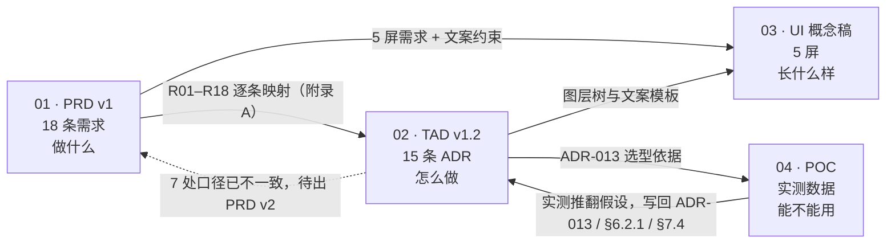

# SceneMate 取景助手 · 项目资料总览

> **一句话**：这不是一台更好的相机，是一台**不用懂相机的相机**——把"该怎么拍"翻译成「你站哪、手机往哪指、参数用什么」三个可执行动作。
>
> 本文是全部资料的唯一入口。任何一份子文档单独打开都可能断章取义，**先读这里再看细节**。

| 项 | 当前状态 |
|---|---|
| 阶段 | 架构设计完成（TAD v1.2），**Android P0 已实现并通过构建/单测**，待真机验证 |
| 首发范围 | Android 单端 · P0 八条需求（R01–R08）· 10 周 |
| 商业模式 | 免费 · 无内购 · 云端走 BYOK（用户自带密钥） |
| 资料版本 | PRD v1（10-29）／ TAD v1.2（10-30）／ POC（10-29）／ App 代码（11-01） |
| 阻塞项 | **2 条**：APP 备案、生成式 AI 备案义务判定（均 W6 截止） |
| 已知欠账 | PRD 与 TAD 有 7 处口径不一致，PRD v2 尚未对齐（见文末） |

---

## 一、目录结构

```
scenemate/
├── README.md                                  ← 你在这里
├── 01-prd/
│   └── prd-scenemate-2026-10-29.md            PRD v1 · 538 行
├── 02-architecture/
│   └── tech-architecture-scenemate-2026-10-29.md   TAD v1.2 · 1702 行 · 15 条 ADR
├── 03-design/
│   └── scenemate-ui.html                      5 屏高保真概念稿 · 46KB
├── 04-poc/
│   ├── poc-deepseek-vision-2026-10-29.md      DeepSeek 实测报告 · 199 行
│   ├── poc_deepseek_scene.py                  可复用评测脚本 · 250 行
│   ├── poc-result.json                        5 次调用的原始输出与耗时
│   └── assets/
│       └── sample-beach-sunset.png            测试素材（AI 生成，模拟 S1 逆光）
└── 05-app/                                    ★ Android 工程（Kotlin + Camera2 + ML Kit）
    ├── README.md                              构建方式 / 代码映射 / 已知问题
    ├── app/src/main/java/com/scenemate/app/   domain / capability / platform / presentation
    └── app/src/test/                          48 条 JVM 单测
```

| 文件 | 是什么 | 什么时候看 |
|---|---|---|
| **01-prd** | 18 条需求（P0×8 / P1×6 / P2×4）、7 种异常态、三档定价、W1–W14 甘特、7 条风险 | 想知道「做什么、为谁做、凭什么赢」 |
| **02-architecture** | 8 条架构结论、15 条 ADR、四条管线、性能预算、成本模型、10 周排期、决策台账 | 想知道「怎么做、为什么这么切、哪里会崩」 |
| **03-design** | 5 屏取景界面 + 设计 token + 色彩契约 | 想知道「长什么样、文案多长」 |
| **04-poc** | 真实 API 调用数据：延迟、成本、稳定性、失败模式 | 想知道「大模型到底能不能用、用在哪」 |
| **05-app** | Android P0 工程（Kotlin · Camera2 · ML Kit bundled · Compose），48 条单测 | 想知道「现在能跑成什么样、还差什么」 |

> 三份文档的头部都做了相互引用，路径是相对路径（`../01-prd/...`），移动整个 `scenemate/` 目录不会断链。

---

## 二、按角色的阅读路径

| 角色 | 读什么 | 大约耗时 |
|---|---|---|
| **决策者 / 投资人** | 本文 §三 → TAD §0「一页纸摘要」 → TAD §16「决策台账」 | 15 分钟 |
| **产品** | 本文 → PRD 第 1/2/6 章 → TAD §16.2 待拍板 | 40 分钟 |
| **架构 / 技术负责人** | TAD 全文，重点 §5 管线、§6 几何、§7 云端、§14 守护 | 2 小时 |
| **开发** | TAD §5（管线与预算）+ §8（Schema）+ 附录 A（需求追溯） | 1 小时 |
| **QA** | TAD §12.4（测试策略）+ §14（fitness function）+ PRD §6 验收 | 40 分钟 |
| **法务 / 合规** | TAD §10（隐私与合规）+ ADR-006 + ADR-015 | 30 分钟 |
| **想验证 DeepSeek 能不能用** | 04-poc 报告全文，然后自己跑一遍脚本 | 30 分钟 |

---

## 三、关键结论速览

### 3.1 八条架构主张（TAD §0）

| # | 结论 | 一句话理由 |
|---|---|---|
| A1 | **端侧规则是唯一保底，云端是默认关闭的增强** | 断网可用是硬需求；云端实测 2.2s，且按次计费会随规模吃掉毛利 |
| A2 | **双管线物理隔离** | 快门 P90<200ms 是红线，任何锁竞争都会击穿 |
| A3 | **「建议」是一等数据对象，不是代码分支** | 可下发、可灰度、可回放、可归因；v2 自动接管只加一个 Actuator |
| A4 | **端侧感知复用系统能力，自研收敛在几何层** | Android 用 ML Kit bundled（不依赖 GMS），v1 不训练任何模型 |
| A5 | **控制量用「像素占比」，展示量才用「米数」** | 绝对距离 P90 误差 32cm 不可救，但相对位移误差只有 2.3cm |
| A6 | **云端走 BYOK，我方不代付、不中转** | 免费模式无法承担按次成本；顺带消解数据合规 |
| A7 | **Android 先发，姿态关键点为主、分割降级** | 国内安卓多数无 GMS，主体分割不可用；姿态有 bundled 版 |
| A8 | **首发只交付 P0，图层树只实现 4 层** | 10 周窗口铺满 18 条需求必然延期 |

### 3.2 三个反直觉的实测/推算结果

这三条是本文档最有价值的部分——它们推翻了 PRD 的三个隐含假设。

**① 「±20cm 距离精度」按默认身高做不到，实测推算 P90 = 32cm**

误差分解（3m 处）：焦距 0.9cm + **身高假设 15.3cm** + 分割框 9cm + 俯仰 6.9cm。
更麻烦的是系统性偏差：1.55m 的被摄者按 1.70m 估算，会稳定偏 26.5cm，**多帧平均消不掉**。
→ 对策不是硬撑精度，而是**换控制量**：闭环用像素占比（无量纲），指令只给「半步 / 一步」，`sigma > 0.3m` 时不显示米数。验收口径改为**指令正确率 ≥90%**。

**② 「云端 1fps 全量抽帧」成本是收入的 200 倍量级**

按 5 万 DAU、3% 付费、¥128/年算，每 DAU 月收入仅 ¥0.32，而全量云端抽帧月成本 ¥13.5–67.5。
→ 云端只做增强，且改成 BYOK 后我方成本归零。

**③ DeepSeek 默认温度下，同一张图会给出互相矛盾的方向**

三次调用分别是「向右 0.6m」「向左半步」「向左半步」。**固定 `temperature=0` 后四次完全一致**。
→ 必须固定温度 + `frame_hash` 缓存 30s + 建议版本单调 + 最小展示 1.2s，否则取景框会左右乱跳，用户信任一次就崩。

### 3.3 DeepSeek 实测数据（04-poc）

| 指标 | 实测 | 判定 |
|---|---|---|
| 延迟 P50 / P90 | **2285ms / 2368ms**（temp=0，n=4） | ❌ 进不了实时链路（R01 要 800ms） |
| 单次成本 | **¥0.0041–0.0042**（高峰）／ ¥0.0021（空闲） | ✅ BYOK 下不构成我方成本 |
| Schema 校验 | **5/5 通过** | ✅ 禁止词、actor、参数范围全部合规 |
| 标签质量 | `beach_sunset` / `backlit` / `person×1`，置信 0.86–0.92 | ✅ 可用 |

**结论**：能接，但只能接在**异步增强槽位**（用户上滑抽屉、低置信难例复核），实时站位框仍由端侧几何给。
附带利好：DeepSeek 高峰是工作日 9–12、14–18 点，而日落场景在 18 点后——**拍照高峰与 API 高峰错开**。

---

## 四、文档之间怎么咬合



**三条硬链接**（改动会连锁）：

1. **PRD 需求 → TAD 附录 A 追溯矩阵**：新增需求时，先看它落在哪个模块，再决定要不要改结构。设计上目标是「加需求不改结构，只注册生产者与图层」。
2. **TAD ADR-013 → POC 报告**：模型选型的每一条结论都有实测数据支撑，不是纸面判断。模型名是别名（`deepseek-v4-flash-vision-exp` 两个月就被接管），所以 `ModelProvider` 适配层是必需的。
3. **TAD §16 决策台账 → 两份文档**：D-01～D-08 是已定案，不再讨论；§16.2 的 8 条里只有 2 条真阻塞。

---

## 五、现在卡在哪

### 5.1 两条真阻塞（W6 前必须有答案）

| # | 问题 | 不定的后果 |
|---|---|---|
| 1 | **APP 备案谁办、多久下号** | 拿不到备案号 = 上不了国内安卓渠道，10 周计划作废。备案有 4 周 lead time，W6 提交、W10 才可能下号 |
| 2 | **生成式 AI 备案义务是否触发** | 若触发需额外 4–6 周，首发只能改内测。BYOK 下我方不提供生成能力，但需法务书面确认 |

### 5.2 六条已给默认值，产品不反对即执行

| # | 问题 | 默认执行方案 | 截止 |
|---|---|---|---|
| 3 | 「采纳」隐式算不算 | 算，记 `adopt_mode=implicit`，对外用 strict 口径 | W4 |
| 4 | 距离 ground truth | 卷尺 30 组 + Replay Harness 双轨 | W2 |
| 5 | 「2 秒可用构图」谁定义 | 端侧规则产出「三分线 + 站位框」即算，标 `source=fallback` | W4 |
| 6 | 低置信是否降级为纯构图 | 是，按场景关能力并明说 | W5 |
| 7 | iOS 后置启动时点 | Android 提审通过后启动，不并行 | W9 |
| 8 | 米数显示阈值 | `sigma > 0.3m` 只给半步 / 一步 | 已可实现 |

### 5.3 一个必须守住的技术门槛

**W1 的「姿态外接框 P90 精度实测」是 Go/No-Go 门槛。**
Android 首发放弃了分割 mask（无 GMS 不可用），改用 33 个姿态关键点 + 人体比例常数推导主体外接框。这是**唯一可能推翻整个 R01 的技术假设**——M0 必须先测，不达标就走 ADR-014 的 Plan B（回退到 Selfie Segmentation + 保守框）。

---

## 六、怎么复现 POC

```bash
# 依赖：requests、Pillow
# 密钥：环境变量 DEEPSEEK_API_KEY
cd 04-poc
python poc_deepseek_scene.py assets/sample-beach-sunset.png --repeat 3
python poc_deepseek_scene.py <你的图> --repeat 5 --json-out result.json
```

脚本模拟 App 真实上传方式（720px、JPEG q70、关闭思考模式、`temperature=0`），输出延迟分位、成本估算、Schema 校验结果。

**下一步建议**：拿 **30 张真实照片**跑一遍人工打分，重点看三件事——标签准确率、多人/遮挡是否误判、同一场景连拍方向会不会翻。2 小时、不到 ¥20，比继续争论「自研还是采购」划算。

---

## 七、变更时间线

| 日期 | 事件 | 影响文档 |
|---|---|---|
| 10-29 | PRD v1 完成（18 条需求、77 人日、14 周双端） | 01-prd |
| 10-29 | TAD v1.0 首版（12 条 ADR） | 02-architecture |
| 10-29 | DeepSeek 真实调用 5 次，得出「2.3s 进不了实时链路」 | 04-poc |
| 10-29 | 决策：指令 `actor=subject`（「让她…」）、v1 跳过身高输入 | TAD §6.2.1 / §6.4 |
| 10-30 | TAD v1.1：回填上述三项决策 + ADR-013 | 02-architecture |
| 10-30 | **四项结构性决策**：Android 先发 / 只做 P0 / 免费 + BYOK / 公开上架 | TAD v1.2（ADR-014、ADR-015、§12.5、§10.6） |
| 11-01 | **资料归集**：四类材料合并到 `scenemate/`，修正交叉引用与 1 处优先级标注错误 | 全部 |

---

## 八、已知欠账

**PRD 与 TAD 目前有 7 处口径不一致**，都是 10-30 四项决策带来的：

| # | PRD 写的 | TAD 已改 |
|---|---|---|
| 1 | iOS 先发，双端 14 周 | Android 先发，iOS 后置 4 周 |
| 2 | 18 条需求全量交付 | 首发只做 R01–R08（10 周） |
| 3 | 付费订阅 ¥98–168/年 | 免费，无内购 |
| 4 | 云端 1fps 抽帧识别场景 | 端侧规则为主，云端 BYOK 增强 |
| 5 | 距离误差 ≤±20cm | 指令正确率 ≥90%（32cm 无法达标） |
| 6 | 分割 mask 算主体包围盒 | 姿态关键点推导外接框 |
| 7 | 前端用 CameraX 保底 | 直接用 Camera2 |

**建议顺序**：先让架构评审过一轮（确认 A1–A8 与 ADR 无异议），再据此出 PRD v2。反过来做的话，PRD v2 可能要改两遍。
